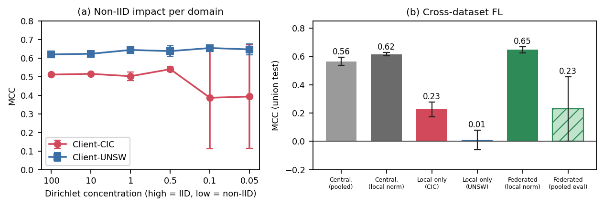
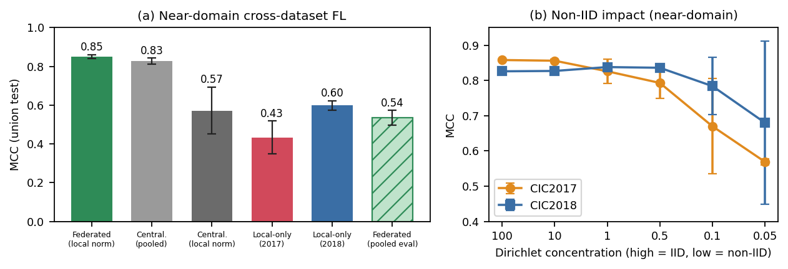
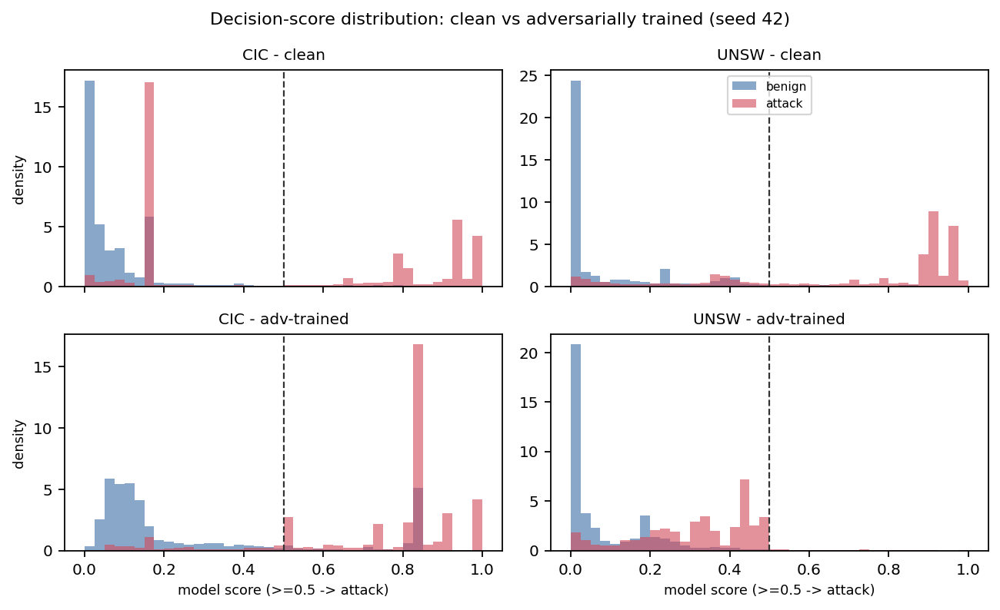

# Federated Learning for Network Intrusion Detection Systems: A Survey with Reproducible Verification and Adversarial Experiments on a Cloud Testbed

> **Judul paper (English, final untuk JICTRA)** = baris di atas.
>
> **Opsi judul English (arsip; final = baris di atas):**
> 1. *Federated Learning for Network Intrusion Detection Systems: A Survey with
>    Reproducible Verification and Adversarial Experiments on a Cloud Testbed* ← dipilih
> 2. *Does It Still Hold? A Survey of Federated Learning for Network Intrusion
>    Detection with Reproducible Verification on AWS*
> 3. *From Reading to Running: A Reproducible Survey of Federated Learning for
>    Network Intrusion Detection on a Public Cloud Testbed*
> 4. *Federated Learning for Network Intrusion Detection: A Survey and Controlled
>    Reproduction Study with Adversarial Evaluation*
> 5. *Beyond the Literature: A Reproducible Survey of Federated Learning for Network
>    Intrusion Detection with Cross-Dataset and Adversarial Verification on AWS*
>
> **Judul kerja (Indonesia, bukan untuk submit):** Federated Learning untuk Network
> Intrusion Detection System (NIDS): Sintesis Literatur dan Verifikasi Reproduktif di
> Lab Cloud AWS.
>
> **Catatan baca.** Dokumen ini disusun **berurutan seperti naskah paper**: Abstrak →
> Bagian 1–7 → Referensi. Semua **catatan kerja, perencanaan, dan rencana lab** ada di
> **LAMPIRAN** di bagian paling bawah (tidak masuk naskah). Target: **JICTRA (ITB)**,
> Sinta 1 / Scopus Q3. Status: **draf — Bagian 1 sudah narasi penuh; Bagian 2–7 campur
> narasi & kerangka; angka lab `[TBD]`.**
>
> **Daftar isi naskah (judul bab English, isi Indonesia):**
> Abstract · 1 Introduction · 2 Survey Methodology · 3 Thematic Review ·
> 4 Reproduction Study & Adversarial Experiments on AWS ·
> 5 Discussion: Gaps, Research Agenda & Threats to Validity · 6 Conclusion ·
> References · (Lampiran: catatan kerja)

---

## Abstract

Federated Learning (FL) menjanjikan pelatihan Network Intrusion Detection System (NIDS) kolaboratif lintas-organisasi tanpa memusatkan data trafik yang sensitif. Namun literatur FL-NIDS terfragmentasi: dataset, arsitektur, agregasi, dan protokol evaluasi berbeda antar-studi, sehingga klaim sulit dibandingkan dan bukti deployment cloud langka. Makalah ini menyajikan survei FL-NIDS 2020–2026 dalam empat tema dan, berbeda dari survei terdahulu, menguji empiris klaim representatif dari metode yang sudah terpublikasi pada testbed Amazon Web Services (AWS) yang seragam dengan CSE-CIC-IDS2018 dan UNSW-NB15, termasuk evasion (FGSM, PGD, JSMA) dan adversarial training. Satu klaim bertahan (model sehat sangat rapuh: attack success rate 0,91 pada ε=0,1), dua tidak bertahan (FedProx tidak mengungguli FedAvg; FL lintas-dataset tidak runtuh, MCC 0,65 versus 0,62 terpusat), dan dua bergantung domain (dampak non-IID; adversarial training menaikkan robustness pada CIC tetapi merusak UNSW). Kami juga menunjukkan bahwa kesimpulan lintas-dataset sensitif terhadap protokol normalisasi: evaluasi tak konsisten menurunkan MCC federated dari 0,65 menjadi 0,23 rata-rata. Biaya cloud kecil (≈300 KB dan ≈16 detik per ronde).

**Kata kunci:** federated learning; network intrusion detection; non-IID data;
adversarial robustness; cross-dataset generalization; cloud deployment; reproducibility.

---

## 1. Introduction

Network Intrusion Detection System (NIDS) berbasis pembelajaran mesin kini menjadi
komponen inti pertahanan siber, dari jaringan enterprise hingga Internet of Things
(IoT) dan Industrial IoT. Namun model yang akurat menuntut data lalu lintas yang
besar dan representatif, sementara data semacam itu bersifat sensitif dan jarang
boleh keluar dari batas organisasi karena alasan privasi serta kepatuhan regulasi.
Tarik-menarik inilah—antara kebutuhan data lintas-organisasi dan larangan berbagi data
mentah—yang mendorong minat besar pada pembelajaran terdistribusi untuk keamanan
jaringan.

Federated Learning (FL) menawarkan jalan keluar yang menarik: alih-alih memusatkan
data, setiap client melatih model pada datanya sendiri dan hanya mempertukarkan
pembaruan model (bobot atau gradien), sehingga data mentah tetap berada di sisi
masing-masing organisasi [1]. Dalam satu dekade terakhir, penerapan FL untuk NIDS
tumbuh pesat dan telah dirangkum oleh sejumlah survei dan taksonomi yang memetakan
arsitektur, strategi agregasi, serta tantangan terbukanya [1], [2], [3], [4].

Meski menjanjikan, FL untuk NIDS menghadapi tiga tantangan mendasar yang berulang di
seluruh literatur. Pertama, **heterogenitas data (non-IID)**: lalu lintas dan pola
serangan tiap organisasi berbeda, dan telah ditunjukkan bahwa FedAvg—algoritma
agregasi baku—menurun tajam ketika distribusi antar-klien menyimpang, bahkan gagal
pada skenario lintas-dataset [4], [5]. Kedua, **kerentanan adversarial dan
Byzantine**: model deteksi dapat dikelabui oleh perturbasi masukan yang kecil
(evasion), sedangkan klien jahat dapat meracuni model global melalui pembaruan yang
dimanipulasi [6], [7], [8]. Ketiga, **serangan baru dengan data terbatas**:
sistem harus mengenali serangan zero-day dari sedikit contoh, memotivasi pendekatan
few-shot dan transfer lintas-domain [9], [10].

Di tengah kemajuan ini, muncul satu masalah yang justru menyulitkan pembaca dan
praktisi: **klaim performa FL-NIDS sulit dibandingkan antar-makalah.** Setiap studi
memakai dataset, arsitektur model, strategi agregasi, dan protokol evaluasi yang
berbeda, sehingga angka yang dilaporkan tidak setara dan tidak dapat ditumpuk menjadi
kesimpulan tunggal. Survei yang ada mengompilasi hasil-hasil ini secara apik, tetapi
tetap bersifat telaah pustaka—merangkum apa yang dilaporkan penulis asli tanpa
menguji ulang apakah klaim itu bertahan pada lingkungan yang terkontrol dan setara.
Terlebih lagi, bukti **deployment pada cloud publik berskala** nyaris tidak ada:
sebagian besar validasi dilakukan di testbed edge kecil atau simulasi, sehingga biaya
komunikasi, latensi, dan throughput di dunia nyata belum terdokumentasi dengan baik.

Makalah ini menjawab kesenjangan tersebut dengan pendekatan survei dua-lapis.
**Lapisan pertama** adalah telaah tematik: kami mengorganisasi literatur FL-NIDS
terkini (2020–2026) ke dalam empat tema—arsitektur dan strategi agregasi, penanganan
heterogenitas (non-IID), robustness adversarial dan Byzantine, serta few-shot/transfer
lintas-domain. **Lapisan kedua**, yang membedakan survei ini dari survei terdahulu,
adalah **verifikasi empiris**: kami menjalankan ulang sejumlah klaim representatif
dari **metode yang sudah terpublikasi** (mis. FedAvg, FedProx) pada **satu testbed
Amazon Web Services (AWS) yang seragam**, dengan model, hyperparameter, dan metrik
yang dikontrol, menggunakan dua dataset benchmark publik: CSE-CIC-IDS2018 dan
UNSW-NB15. Dengan begitu, pembaca memperoleh angka yang sebanding pada satu platform,
bukan agregat lintas-makalah yang tidak setara. Kami menegaskan bahwa survei ini
**tidak** mengusulkan metode baru dan **tidak** memakai teknik penyelarasan fitur
milik kami sendiri yang masih dalam proses tinjauan; untuk kebutuhan lintas-dataset,
kami memakai penyelarasan nama fitur manual yang sudah lazim di literatur [5]
sebagai bagian dari setup eksperimen.

Melampaui reproduksi, kami juga menutup sebagian celah yang diakui kosong oleh
literatur, yaitu integrasi FL dengan robustness adversarial yang **diuji secara
lintas-dataset**. Kami menjalankan eksperimen evasion menggunakan FGSM (*Fast Gradient
Sign Method*), PGD (*Projected Gradient Descent*), dan serangan berbasis saliency
JSMA (*Jacobian-based Saliency Map Attack*), lalu menguji adversarial training sebagai
pertahanan—semuanya metode yang sudah ada—pada FL-NIDS lintas-dataset di cloud. FGSM
membangkitkan perturbasi satu langkah searah tanda gradien; PGD adalah versi iteratif
yang lebih kuat; JSMA memilih fitur paling berpengaruh melalui peta saliency. Yang
baru di sini adalah **buktinya**, bukan metodenya.

Kontribusi makalah ini dapat diringkas sebagai berikut. (1) Telaah tematik mutakhir
FL-NIDS dengan tabel komparatif yang secara eksplisit menandai apakah tiap karya
diuji lintas-dataset dan apakah memiliki bukti deployment cloud—dua dimensi yang
jarang dibuat survei lain. (2) Verifikasi reproduktif terkontrol atas klaim inti
(FedAvg versus FedProx, dampak non-IID, dan kelayakan FL lintas-dataset) pada testbed
AWS yang seragam, lengkap dengan laporan mana klaim yang bertahan dan mana yang
tidak. (3) Pengukuran biaya deployment cloud nyata—komunikasi, latensi, dan
throughput—yang menutup sebagian celah bukti produksi. (4) Eksperimen robustness
adversarial (evasion dan adversarial training) pada setting lintas-dataset yang belum
pernah diuji bersama. (5) Protokol evaluasi dan resep lab yang dapat direproduksi
dengan anggaran cloud wajar, sebagai baseline bagi komunitas riset—khususnya di
Indonesia—sebelum membangun kontribusi lanjutan.

Untuk mengarahkan kedua lapisan tersebut, kami merumuskan enam pertanyaan survei
(SQ). SQ1–SQ3 memandu lapisan telaah: bagaimana lanskap arsitektur dan agregasi
FL-NIDS saat ini dan mana yang dominan (SQ1); seberapa parah non-IID menurunkan
performa dan solusi apa yang terbukti (SQ2); serta sejauh mana robustness adversarial
dan Byzantine telah dicapai (SQ3). SQ4–SQ6 memandu lapisan verifikasi: apakah klaim
representatif (FedAvg versus FedProx, dampak non-IID, dan FL lintas-dataset) bertahan
saat direproduksi pada testbed AWS seragam (SQ4); berapa biaya nyata komunikasi,
latensi, dan throughput saat FL-NIDS di-deploy di cloud (SQ5); serta seberapa rapuh
FL-NIDS terhadap evasion—termasuk serangan berbasis saliency—dan seberapa jauh
adversarial training memulihkannya pada setting lintas-dataset (SQ6).

Sisa makalah ini disusun sebagai berikut. Bagian 2 menjelaskan metodologi survei
(protokol pencarian, kriteria inklusi, dan ekstraksi data). Bagian 3 menyajikan
telaah tematik atas keempat tema beserta tabel komparatif. Bagian 4 memaparkan studi
reproduksi dan eksperimen adversarial pada testbed AWS. Bagian 5 membahas pemetaan
celah, agenda riset, dan ancaman validitas; Bagian 6 menutup dengan kesimpulan.

---

## 2. Survey Methodology

Metodologi survei ini terdiri atas dua komponen yang saling melengkapi. Komponen
pertama adalah protokol telaah pustaka yang sistematis untuk membangun taksonomi
tematik (Bagian 3). Komponen kedua—yang membedakan survei ini dari survei
terdahulu—adalah protokol verifikasi reproduktif yang memandu eksperimen pada
testbed cloud (Bagian 4). Kami memaparkan keduanya secara berurutan agar pembaca
dapat menilai cakupan maupun keterulangannya.

### 2.1 Literature search protocol

Pencarian literatur dilakukan dalam tiga fase yang saling melengkapi untuk
memastikan cakupan menyeluruh terhadap tiga poros utama FL-NIDS. Fase pertama
menyasar federated learning untuk NIDS dan generalisasi lintas-dataset; fase kedua
menyasar robustness adversarial dan deteksi DDoS; fase ketiga menyasar few-shot,
meta-learning, dan penyelarasan fitur lintas-domain. Pencarian dijalankan pada basis
data dan mesin telusur akademik—mencakup SciSpace, Google Scholar, dan arXiv—dengan
rentang terbit difokuskan pada 2020–2026 agar relevan dengan perkembangan terkini.
Kueri tiap fase dirumuskan dari kombinasi kata kunci inti (mis. *federated learning*,
*network intrusion detection*, *non-IID*, *adversarial*, *few-shot*,
*cross-dataset*) dan diperhalus secara iteratif berdasarkan hasil awal.

### 2.2 Inclusion and exclusion criteria

Sebuah karya dimasukkan apabila memenuhi seluruh kriteria berikut: (i) terbit dalam
rentang 2020–2026; (ii) berfokus pada federated learning, robustness adversarial,
atau few-shot/transfer dalam konteks deteksi intrusi jaringan; (iii) menyajikan
metodologi eksperimental atau kerangka teknis yang jelas; dan (iv) berupa publikasi
tertelaah sejawat atau pracetak yang kredibel. Karya yang hanya menyinggung FL atau
NIDS secara sepintas, tanpa kontribusi metodologis yang dapat ditelaah, dikeluarkan.

### 2.3 Per-study data extraction

Untuk setiap karya yang lolos seleksi, kami mengekstrak atribut yang seragam agar
dapat dibandingkan antar-studi: arsitektur federasi (horizontal, vertikal, atau
cross-silo); algoritma agregasi (FedAvg, FedProx, atau agregasi khusus); model
pembelajaran mesin atau pembelajaran dalam yang dipakai; teknik penanganan non-IID;
mekanisme pertahanan adversarial atau Byzantine; pendekatan few-shot, meta-learning,
atau transfer; dataset dan metrik evaluasi; serta—penting untuk survei ini—apakah
karya tersebut dievaluasi secara lintas-dataset dan apakah memiliki bukti deployment
pada cloud. Dua atribut terakhir inilah yang menjadi kolom penanda pada tabel
komparatif di Bagian 3 dan langsung menyorot celah yang kami isi di Bagian 4.

### 2.4 Reference consolidation and numbering

Hasil ketiga fase digabung dan dideduplikasi berdasarkan DOI serta judul, karena
sebagian karya muncul di lebih dari satu fase pencarian. Konsolidasi menghasilkan
satu daftar referensi yang rapi dengan satu nomor untuk satu karya; penomoran akhir
mengikuti urutan kemunculan di naskah mengikuti gaya IEEE. Kami juga mencatat bahwa
karya penyelarasan fitur semantik milik kami sendiri masih dalam proses tinjauan;
karya tersebut hanya dirujuk sebagai karya-terkait bila diperlukan dan **tidak**
digunakan sebagai metode dalam survei ini (lihat Bagian 2.5 dan 4.1).

### 2.5 Reproducible verification protocol

Berbeda dari survei murni, kami menambahkan lapisan verifikasi empiris. Prinsipnya
sederhana: alih-alih menerima angka yang dilaporkan tiap penulis apa adanya, kami
memilih sejumlah klaim representatif dari metode yang sudah terpublikasi, lalu
menjalankannya kembali pada **satu testbed yang seragam**—platform, arsitektur
model, hyperparameter, metrik, dan dua dataset benchmark yang sama di seluruh
skenario—sehingga hasilnya sebanding antar-metode. Protokol ini menegakkan tiga
disiplin. Pertama, **keseragaman**: setiap pengaturan memakai model dan pipeline
identik agar perbedaan yang terukur benar-benar berasal dari faktor yang diuji
(agregasi, derajat non-IID, atau lintas-dataset), bukan dari perbedaan
implementasi. Kedua, **kehati-hatian interpretasi**: reproduksi mengukur apakah
*arah* suatu klaim bertahan di lingkungan setara, bukan meniru persis setiap detail
setup penulis asli; perbedaan setup dilaporkan terbuka sebagai ancaman validitas
(Bagian 5.1). Ketiga, **keterulangan**: seluruh langkah, konfigurasi, dan biaya cloud
didokumentasikan agar dapat diulang dengan anggaran wajar. Rincian teknis
testbed—topologi, dataset, model, dan daftar klaim yang diuji—dipaparkan pada
Bagian 4, sedangkan prosedur operasional lengkap disediakan sebagai materi
pelengkap yang dapat direproduksi.

---

## 3. Thematic Review

> Status: kerangka bullet; akan dinaratifkan. Tiap angka dari karya orang lain
> ditandai "(dilaporkan penulis asli)". Jawab SQ1–SQ3.

### 3.1 FL-NIDS Architectures & Aggregation Strategies (SQ1)

Arsitektur yang dominan pada FL-NIDS adalah horizontal cross-silo, di mana beberapa
organisasi atau domain melatih model bersama tanpa berbagi data mentah [1], [11], dan
agregasi bakunya adalah FedAvg yang merata-ratakan bobot klien secara tertimbang
ukuran data [1]. Di atas fondasi ini, literatur mengembangkan sejumlah varian agregasi
yang lebih canggih. Entente [11] memakai Adaptive Contribution Scaling dan graph
sketching untuk deteksi berbasis graf jaringan, dan melaporkan precision/recall tinggi
dengan FPR rendah pada OpTC, LANL Cyber1, dan Pivoting. FedAGRU [12] menambahkan
agregasi berbasis attention pada model GRU-SVM, sementara FedIn-NID [13] mengandalkan
agregasi global dinamis (exponential moving average) dengan pemilihan klien
multidimensi untuk IIoT. Untuk deteksi DDoS, FLAD [14] mengadaptasi FedAvg dengan
pemilihan klien berbasis akurasi validasi dan melaporkan konvergensi yang lebih cepat.
Arah lain menekankan efisiensi: resource-efficient FL [15] berfokus menekan biaya
komunikasi dan komputasi. Secara keseluruhan, inovasi pada lapisan agregasi cukup
kaya, tetapi mayoritas diuji hanya dalam satu jaringan dan jarang lintas-dataset.

### 3.2 Heterogeneity & Non-IID Data (SQ2)

Heterogenitas data adalah tantangan yang paling banyak disorot. Lavaur dkk. [5]
menunjukkan bahwa FL-NIDS menurun drastis pada skenario cross-dataset yang melibatkan
UNSW-NB15, Bot-IoT, ToN_IoT, dan CSE-CIC-IDS2018—bukti bahwa perbedaan distribusi
antar-jaringan, bukan sekadar non-IID ringan antar-klien, dapat meruntuhkan performa.
Untuk mengatasinya, literatur menempuh beberapa jalur. Pendekatan personalisasi dan
klasterisasi berusaha menyesuaikan model ke tiap klien, seperti Sentinel yang memakai
knowledge distillation [16] dan FedDB yang mengelompokkan klien dengan DBSCAN [17].
Jalur lain menyelaraskan fitur atau perilaku antar-domain, misalnya FedCross-VAN [18]
dan graph prior pada Entente [11]. Ada pula yang menata arsitektur secara hirarkis,
seperti mist-assisted FL [19], serta studi yang secara eksplisit membandingkan kondisi
IID versus non-IID [20]. Yang menarik, istilah "semantic feature mapping" jarang
disebut secara eksplisit; penyelarasan fitur lebih sering muncul secara implisit.
Survei ini tidak mengusulkan solusi penyelarasan baru—untuk kebutuhan lintas-dataset
kami memakai penyelarasan nama fitur manual yang sudah ada sebagai bagian dari setup.

### 3.3 Adversarial Robustness & Byzantine/Poisoning (SQ3)

Ketahanan model terhadap serangan dibahas dari dua sisi: evasion pada waktu inferensi
dan peracunan pada waktu pelatihan. Pada sisi evasion, adversarial training menjadi
pertahanan yang paling sering diusulkan; Ennaji dkk. [21] melaporkan akurasi 91,23%
pada Edge-IIoTset, SFAT [6] menyoroti "exacerbated heterogeneity" dan menambahkan
mekanisme α-slack, sedangkan HADA [22] melaporkan akurasi 66–73% di bawah serangan
FGSM/PGD. Pada sisi peracunan, pertahanan Byzantine berupaya menolak pembaruan klien
jahat: FedSecIoT [23] dan karya Saha dkk. [7] memakai agregasi multi-Krum, FORT-IDS
[24] mengandalkan agregasi yang tahan outlier, dan serangan label-flipping juga
teramati pada setting FL-NIDS [5]. Khusus untuk DDoS, GADoT [25] memakai GAN untuk
membangkitkan contoh adversarial saat pelatihan. Beberapa karya menyediakan tolok ukur
dan telaah atas lanskap ini [26], [8], [27]. Benang merahnya, trade-off antara
robustness dan akurasi belum tuntas—apalagi pada kondisi non-IID—dan integrasi evaluasi
adversarial dengan setting cross-dataset masih langka. Celah inilah yang kami uji
sendiri pada Bagian 4 (R5–R6), sehingga tema ini hadir dua sisi: sebagai telaah di
sini dan sebagai eksperimen di sana.

### 3.4 Few-Shot, Meta-Learning & Cross-Domain Transfer (SQ2–SQ3)

Tema terakhir menyasar kemampuan mengenali serangan baru dari sedikit contoh. Pada
jalur few-shot, Ceviz dkk. [10] menerapkannya untuk jaringan UAV, sementara FeCoGraph
[28] memakai pembelajaran kontrastif berbasis graf. Pendekatan meta-learning
diwakili Hu dkk. [9] yang merancang federated meta-learning untuk melawan advanced
persistent threat. Untuk transfer lintas-domain, FedPKT [29] memakai transfer
pengetahuan prototipikal, dan pada arah ensemble, karya [30] menggabungkan CNN, LSTM,
dan Transformer serta melaporkan akurasi 98,5% pada enam dataset dengan konsekuensi
kompleksitas yang tinggi. Secara umum, penggabungan penyelarasan semantik dan few-shot
yang diuji benar-benar lintas-dataset masih jarang; survei ini mencatatnya sebagai
celah terbuka, bukan mengisinya.

### 3.5 State-of-the-Art Comparison Table

Tabel 1 merangkum karya representatif FL-NIDS secara kualitatif. Kolom "Cross-dataset?"
dan "Cloud deploy?" adalah penanda yang jarang dibuat survei lain dan langsung
memperlihatkan celah yang kami isi di Bagian 4. Perlu ditegaskan bahwa kolom
"Performa" **tidak sebanding antar-baris**: tiap karya memakai metrik, dataset, dan
setup yang berbeda (mis. akurasi pada satu dataset tidak setara dengan F1 pada dataset
lain), sehingga angka hanya dikutip apa adanya sebagaimana dilaporkan penulis asli.
Justru ketaksebandingan inilah yang memotivasi verifikasi terkontrol pada testbed
seragam di Bagian 4, di mana metode-metode tersebut dibandingkan dengan metrik dan
data yang sama.

*Table 1. Comparison of representative FL-NIDS frameworks.*

| Framework | Fokus | Metodologi kunci | Dataset | Performa (dilaporkan asli) | Cross-dataset? | Cloud deploy? |
|---|---|---|---|---|---|---|
| Entente [11] | GNIDS cross-silo | ACS + graph sketching | OpTC, LANL, Pivoting | High P/R, low FPR | Tidak | Tidak |
| FedAGRU [12] | FL wireless edge | attention + GRU-SVM | KDD'99, CICIDS2017, WSN-DS | High acc, low FAR | Tidak | Tidak |
| FedSecIoT [23] | Byzantine-robust | Multi-Krum | N-BaIoT | 90%+ acc, +60% robust vs FedAvg | Tidak | Tidak |
| FLAD [14] | FL adaptif DDoS | adaptive selection | CIC-DDoS2019 | High F1, cepat konvergen | Tidak | Tidak |
| HADA [22] | privacy-preserving FL | HADA + SHAP + DP | Edge-IIoTset dll | 85–89% acc, 66–73% under adv | Tidak | Edge |
| Ensemble+XAI [30] | ensemble + XAI | CNN+LSTM+Transformer + GAN def | 6 dataset | 98,5% acc, AUC>0,99 | Multi-dataset | Tidak |
| Hu dkk. [9] | few-shot meta vs APT | federated meta-learning | IDS datasets | adaptasi cepat | Sebagian | Tidak |

---

## 4. Reproduction Study & Adversarial Experiments on AWS

> **Bagian pembeda utama.** Kami menjalankan metode terpublikasi pada **satu testbed
> AWS seragam** dan melaporkan angka yang sebanding. **Semua angka = `[TBD]`** sampai
> eksperimen dieksekusi. Detail operasional (infra, runbook, fase) di Lampiran B.

### 4.1 Testbed design

Sebelum pelatihan, kedua dataset tidak dipakai dengan seluruh fiturnya. CSE-CIC-IDS2018
diekstrak dengan CICFlowMeter (sekitar 80 fitur) sedangkan UNSW-NB15 dengan Argus/Bro
(42 fitur), sehingga skema fiturnya berbeda. Agar kedua client berbicara dalam ruang
fitur yang sama, kami hanya memakai **sembilan fitur** yang memiliki padanan nama 1:1
di kedua ekstraktor—durasi aliran, jumlah dan volume paket arah maju/mundur, rata-rata
ukuran paket, dan laju—sebagai skema bersama (Figure 1). Fitur yang khas pada satu
ekstraktor saja (misalnya `ct_srv_src`, TTL, atau `trans_depth` pada UNSW; fitur IAT
atau flag pada CICFlowMeter) tidak memiliki padanan dan karenanya dibuang. Angka
sembilan ini adalah konsekuensi dari irisan kedua ekstraktor, bukan pilihan desain;
penyelarasan nama fitur manual semacam ini sudah lazim di literatur cross-dataset
[5] dan kami perlakukan sebagai setup, bukan kontribusi. Tiap client lalu menerapkan
skema sembilan fitur ini **pada datanya sendiri**.

*Figure 1. Cross-dataset feature alignment.*

Arsitektur federasi yang kami bangun mengikuti pola horizontal cross-silo dengan satu
**aggregator** dan dua **client**, masing-masing memegang satu dataset—Client-CIC
untuk CSE-CIC-IDS2018 dan Client-UNSW untuk UNSW-NB15 (Figure 2). Setiap client
melatih model pada datanya **sendiri** tanpa pernah mengirim data mentah; yang
dipertukarkan hanyalah bobot model. Normalisasi fitur (z-score) juga dihitung **lokal
per-client** memakai statistik masing-masing, sehingga tidak ada statistik data yang
bocor antar-client—menjaga prinsip privasi FL.

Aliran proses per ronde mengikuti FedAvg standar. Pada tiap ronde, aggregator
mengirimkan model global ke kedua client; setiap client melatihnya secara lokal lalu
mengembalikan pembaruan bobotnya; aggregator menggabungkan kedua pembaruan dengan
FedAvg (rata-rata berbobot ukuran data) untuk membentuk model global ronde berikutnya.
Siklus ini diulang selama 100 ronde. Pada realisasinya, ketiga simpul dijalankan
sebagai tiga instans EC2 `t3.medium` dan pertukaran bobot dimediasi melalui Amazon S3
(tanpa soket langsung antar-node), tetapi detail infrastruktur ini bersifat
operasional dan tidak mengubah model FL itu sendiri; pengukuran biaya komunikasinya
dilaporkan pada R4.

*Figure 2. Federated learning architecture.*

Pelatihan dan evaluasi memakai model yang sama pada semua skenario: MLP ringan
9→128→64→1 (ReLU, keluaran sigmoid, loss cross-entropy biner, 9.601 parameter), dilatih
dengan SGD mini-batch 256 pada laju belajar 0,003, lima epoch lokal per ronde, dan 100
ronde. MLP dangkal ini adalah **controlled backbone** yang dipilih sengaja, bukan demi memaksimalkan
performa: model kecil menjaga payload per ronde tetap mungil (≈76,8 KB per client)—penting untuk
deployment cross-silo dan menjadi objek pengukuran biaya R4—sekaligus mengisolasi efek yang kami
teliti (agregasi, derajat non-IID, transfer lintas-domain, pergeseran skor adversarial) dari dinamika
pelatihan model berkapasitas besar seperti overfitting representasi laten yang perilakunya sulit
diatribusikan di bawah agregasi federated. Karena arsitektur dikunci identik di semua client dan
skenario, perbedaan yang terukur dapat diatribusikan ke faktor yang diuji, bukan ke kapasitas model. Tabel 2 merangkum partisi data tiap client setelah penyelarasan fitur: CSE-CIC-IDS2018
dibagi 70/30 dan bagian latihnya disubsampel terstratifikasi menjadi sekitar 100.000 aliran
agar rasio CIC:UNSW mendekati 1,2:1, sedangkan UNSW-NB15 memakai pembagian latih/uji
bawaannya. Perbedaan rasio serangan antar-domain (16,9% pada CIC, 55,1% pada UNSW latih)
menjadi sumber heterogenitas tambahan. Metrik utama adalah MCC, dengan recall, precision,
dan F1 sebagai pelengkap, serta biaya FL (bytes per ronde dan latensi).

Normalisasi fitur diperlakukan dengan hati-hati karena sangat memengaruhi hasil. Pada run
federated di EC2, z-score dihitung per client dari data latihnya sendiri sehingga tidak ada
statistik yang dibagikan, dan evaluasinya konsisten dengan itu: tiap test set client
dinormalisasi dengan statistik latih client pemiliknya, lalu hasil dilaporkan per client dan
gabungan. Simulasi R1 dan R2 sebaliknya memakai satu z-score global bersama pada training dan
evaluasi—konsisten di dalam dirinya, tetapi tidak menjaga privasi statistik. Baseline terpusat
dilaporkan dengan dua normalisasi (gabungan dan per-domain) agar efek normalisasi terpisah dari
efek federasi. Jumlah seed berbeda antar-eksperimen: tiga seed {13,42,101} untuk R1 dan R2, serta lima seed {13,42,101,202,303} untuk perbandingan FL-versus-lokal dan untuk run EC2 (R3, R5, R6), dilaporkan sebagai rata-rata dan CI95. Partisi data tetap, sehingga variasi mencerminkan keacakan training saja.

*Table 2. Per-client dataset partitions.*

| Client (split) | Total aliran | Serangan | Benign | Rasio serangan |
|---|---|---|---|---|
| CIC (train) | 100.000 | 16.929 | 83.071 | 0,169 |
| CIC (test) | 486.979 | 82.443 | 404.536 | 0,169 |
| UNSW (train) | 82.332 | 45.332 | 37.000 | 0,551 |
| UNSW (test) | 175.341 | 119.341 | 56.000 | 0,681 |

### 4.2 Claims under test
> Dua kelompok: **(A) reproduksi** klaim inti (R1–R4) dan **(B) eksperimen adversarial**
> (R5–R6). Semua memakai metode terpublikasi; yang baru adalah buktinya.

**(A) Reproduksi klaim inti FL-NIDS**
1. **R1 — FedAvg vs FedProx (SQ3/SQ4).** Klaim: FedProx lebih stabil di non-IID [6],[14]. Hasil: pada setting lintas-dataset (klien CIC + UNSW, rata-rata tiga seed), FedAvg dan FedProx **tidak berbeda bermakna**: FedAvg MCC 0,572, FedProx(μ=0,01) 0,573, FedProx(μ=0,1) 0,571 — selisih ≈0,001, dan ketiganya konvergen cepat (7–11 ronde). Pola yang sama muncul pada fondasi single-dataset (α=0,1): FedAvg 0,555 vs FedProx(μ=0,1) 0,553. Di kedua setting FedProx **tidak** memperbaiki FedAvg; arah klaim tidak bertahan pada rentang hyperparameter yang kami uji.
2. **R2 — Dampak non-IID (SQ2/SQ4).** Klaim: performa FL turun seiring heterogenitas [5]; sweep Dirichlet α. Hasil: **dampaknya bergantung domain** — sebuah nuansa yang jarang disorot. Pada klien **CIC**, pola klasik muncul: MCC relatif stabil pada α besar (0,512 di α=100) lalu runtuh dan menjadi sangat tak stabil pada α rendah (0,387 di α=0,1, dengan std melonjak ke 0,27). Sebaliknya pada klien **UNSW**, performa **tidak** turun seiring non-IID — justru datar bahkan sedikit naik (0,621 di α=100; 0,655 di α=0,1). Asimetri ini kami atribusikan terutama pada komposisi kelas data latih, bukan sekadar separabilitas: CIC sangat condong-benign (16,9% serangan), sehingga partisi Dirichlet ekstrem dapat menyisakan sebagian shard lokal dengan terlalu sedikit sampel serangan untuk mempelajari kelas minoritas sehingga agregat runtuh dan tak stabil; sementara UNSW mayoritas-serangan (55,1%), sehingga partisi ekstrem pun menyisakan subset serangan yang cukup pekat di tiap shard untuk konvergensi lokal. Jadi klaim "non-IID menurunkan FL" **bertahan pada CIC tetapi tidak pada UNSW**: efeknya nyata namun tidak universal, dengan rasio serangan sebagai penyebab yang masuk akal. Pada fondasi single-dataset penurunan juga tegas (0,826 di α=100 → 0,555 di α=0,1, CI membengkak ~46×).
3. **R3 — Cross-dataset FL (SQ4).** Klaim: FL lintas-dataset sulit/menurun tajam [5]; diuji pada testbed AWS tiga-EC2 (100 ronde FedAvg, client CIC dan UNSW, lima seed) dengan penyelarasan nama fitur manual. Hasil: klaim **tidak bertahan** pada protokol evaluasi yang konsisten. Bila setiap test set dinormalisasi dengan statistik client pemiliknya (sama seperti saat training), model federated mencapai MCC 0,647 ± 0,020 pada test gabungan (rata-rata dan CI95 lima seed; CIC 0,533; UNSW 0,610). Model *centralized* (data digabung, tidak diizinkan di FL nyata) mencapai 0,565 ± 0,028 dengan normalisasi gabungan dan 0,616 ± 0,012 dengan normalisasi per-domain; pada normalisasi yang sepadan, federated sedikit tetapi konsisten lebih baik (selisih +0,031; uji Welch p=0,009). Yang gagal berpindah antar-domain adalah model *local-only*: yang dilatih di CIC mencapai 0,226 ± 0,052 pada test gabungan (UNSW −0,223), dan yang dilatih di UNSW hanya 0,010 ± 0,068 (CIC −0,088). Jadi federasi memang menutup jurang antar-domain. Temuan metodologis penting: bila model federated yang sama dievaluasi dengan statistik gabungan—tidak konsisten dengan cara ia dilatih—MCC turun ke rata-rata 0,229 ± 0,228 dan bervariasi liar antar-seed (−0,026 hingga 0,425), sehingga kesimpulan dari evaluasi semacam itu bersifat pesimistis sekaligus tidak stabil.
4. **R4 — Biaya cloud nyata (SQ5).** Efisiensi komunikasi FL [15]: komunikasi/latensi per ronde di AWS. Hasil: model ringan 9.601 parameter → 76,8 KB per unggahan klien, sehingga ≈300 KB lalu lintas agregator per ronde untuk dua klien (dua arah) — ongkos komunikasi sangat kecil. Dari jejak waktu objek pada run S\_R3 (tiga EC2 `t3.medium`, bobot via S3), 100 ronde memakan ≈27 menit (round 0 → ronde final), yakni ≈16 detik per ronde termasuk sinkronisasi S3; angka ini diukur saat dua run berjalan paralel sehingga menanggung CPU bersama (batas atas latensi, dilaporkan apa adanya).

Sebagai pemeriksaan dasar bahwa federasi memang bermanfaat, kami membandingkan model
federated dengan baseline *local-only* (tiap klien melatih sendiri tanpa agregasi)
lintas lima seed: federated mencapai MCC 0,574 (CI95 0,565–0,583) versus local-only
0,364 (0,306–0,422), selisih +0,210 yang signifikan secara statistik (paired *t*-test
p=0,0005). Jadi agregasi federated memberi keuntungan nyata di atas pelatihan lokal
terisolasi — prasyarat yang harus dipenuhi sebelum klaim-klaim lanjutan bermakna.

**(B) Eksperimen adversarial**
5. **R5 — Kerentanan evasion (SQ6).** Klaim: NIDS ML rapuh terhadap evasion [25],[26],[8]. **Model ancaman kami nyatakan eksplisit:** serangan bekerja di ruang fitur aliran (tabular) dengan asumsi white-box, dan perturbasi di-clip per fitur ke persentil 1–99 data latih tetapi **tidak** dibatasi menjaga konsistensi protokol antar-fitur (mis. mengubah durasi tanpa menurunkan ulang jumlah byte/paket terkait). ASR karenanya adalah ukuran **kerentanan ruang-fitur sebagai batas-atas worst-case**, bukan *packet-level deliverability*; kami tidak mengklaim aliran terperturbasi dapat benar-benar dikirim di jaringan. Pembingkaian ini disengaja: ia mengisolasi seberapa rapuh permukaan keputusan model, terlepas dari usaha rekayasa yang diperlukan penyerang nyata. Diuji dengan FGSM, PGD, dan JSMA terhadap model federated R3, dengan ε ∈ {0,05; 0,1; 0,2; 0,5}. ASR dihitung hanya pada serangan yang terdeteksi sebelum diserang; semua angka adalah rata-rata lima seed. Hasil: klaim **bertahan**, pada basis yang sehat (recall dasar 0,61; MCC 0,647). Pada ε=0,05, FGSM dan PGD membuat 58–59% serangan yang semula terdeteksi lolos (JSMA 37%) dan MCC turun ke sekitar 0,33 (JSMA 0,46); pada ε=0,1 ASR mencapai 0,89 (FGSM) dan 0,91 (PGD) dengan MCC 0,04–0,07 (JSMA: ASR 0,70; MCC 0,24); pada ε ≥ 0,2 FGSM dan PGD mencapai ASR ≥ 0,98 dan MCC menjadi negatif (sekitar −0,08 pada 0,2 dan −0,11 pada 0,5). FGSM dan PGD hampir sama efektif dan stabil antar-seed (interval 95% ASR dalam ±0,06), sedangkan JSMA yang hanya mengubah dua fitur lebih lemah dan lebih bervariasi (ASR 0,37; 0,70; 0,91 pada ε 0,05; 0,1; 0,2). Kerapuhan berbeda antar-domain: pada ε=0,05 ASR UNSW (0,70–0,71 untuk FGSM/PGD) jauh di atas CIC (0,32–0,33), dan pada ε=0,1 UNSW hampir seluruhnya lolos (0,99) dibanding 0,68–0,74 pada CIC.
6. **R6 — Adversarial training sebagai defense (SQ6).** Klaim: adversarial training menaikkan robustness dengan trade-off [6],[21],[27]; pada run S\_R6 setiap client mengganti 50% sampel latihnya dengan contoh FGSM (ε=0,1), lalu dibandingkan dengan model bersih S\_R3 di bawah PGD ε=0,1 (rata-rata lima seed). Hasil: **bergantung domain**. Pada CIC adversarial training efektif: MCC di bawah serangan naik dari 0,149 ke 0,500 dan ASR turun dari 0,74 ke 0,13, sementara performa bersih juga membaik (MCC 0,533 → 0,585; recall 0,48 → 0,91). Pada UNSW model terdegradasi secara konsisten: MCC bersih turun dari 0,610 ke 0,170 (berkisar 0,07–0,27 pada kelima seed, tidak pernah di atas 0,27) dan recall dari 0,70 ke 0,10, sehingga MCC di bawah serangan (0,016) kehilangan makna. Pada test gabungan, MCC di bawah serangan naik (0,038 → 0,182) tetapi MCC bersih turun dari 0,647 ke 0,284. Seluruh perbedaan ini bermakna antar-seed (uji Welch p<0,01), dan karena degradasi UNSW muncul pada setiap seed, ia bukan ketidakstabilan pelatihan sesaat; penyebabnya kami selidiki pada Bagian 5 (pergeseran skor keputusan antar-domain). ASR gabungan model adv-trained (0,24) tidak sebanding dengan model bersih (0,91) karena dihitung pada himpunan serangan terdeteksi yang jauh lebih kecil, sehingga perbandingan sebaiknya per domain dan lewat MCC.

### 4.3 Results table

> **Catatan sumber angka.** R1, R2, R4-komunikasi, dan perbandingan FL-versus-lokal adalah
> **simulasi terkontrol** di notebook (FedAvg/FedProx/MLP identik dengan node EC2) dengan satu
> z-score global bersama pada training dan evaluasi; R1 dan R2 memakai tiga seed, FL-versus-lokal
> lima seed. **R3, R5, R6 dijalankan nyata** pada testbed AWS tiga-EC2 `t3.medium` (100 ronde
> FedAvg, z-score lokal per client): R3 dari run bersih (S\_R3), R6 dari run adversarial-training
> (S\_R6), dan R5 adalah evaluasi evasion offline terhadap S\_R3. Ketiganya lima seed dengan CI95 (partisi data tetap). R4-latensi diturunkan dari jejak waktu objek S3 per ronde. Fondasi
> single-dataset (CSE-CIC-IDS2018, K=4, lima seed) dilaporkan sebagai pembanding. Batasan lain
> dibahas pada Bagian 5.1.

*Table 3. Verification results for the six FL-NIDS claims.*

| Klaim | Jenis | Sumber literatur | Metrik | Angka dilaporkan asli | **Angka lab kami** | Bertahan? |
|---|---|---|---|---|---|---|
| R1 FedProx>FedAvg (non-IID) | reproduksi | [6][14] | MCC (cross-dataset, 3 seed) | [kutip] | FedAvg 0,572 vs FedProx(μ=0,1) 0,571; selisih ≈0,001, tak bermakna | **Tidak** |
| R2 non-IID menurunkan FL | reproduksi | [5] | MCC vs α per domain | [kutip] | CIC: 0,512→0,387 (α=100→0,1), runtuh & tak stabil. UNSW: 0,621→0,655, datar | **Bergantung domain** (ya di CIC, tidak di UNSW) |
| R3 cross-dataset FL sulit | reproduksi | [5] | MCC (test gabungan) | [kutip] | federated 0,647 ± 0,020 vs terpusat 0,616 ± 0,012 (norm. lokal) / 0,565 (gabungan); local-only 0,23 / 0,01. Evaluasi tak konsisten: 0,229 ± 0,228 | **Tidak** (sensitif protokol) |
| R4 biaya komunikasi | reproduksi | [15] | bytes/round, latensi | [kutip] | 76,8 KB/unggahan; ≈300 KB/ronde (2 klien); ≈16 s/ronde (CPU bersama) | — |
| R5 evasion FGSM/PGD/JSMA | adversarial | [25][26][8] | ASR (terdeteksi→lolos), MCC | [kutip] | ASR 0,58–0,59 (ε=0,05) → 0,89–0,91 (ε=0,1) → ≥0,98 (ε≥0,2); MCC 0,65 → 0,04–0,07 (ε=0,1) | **Ya** |
| R6 adversarial training | adversarial | [6][21][27] | robust MCC, MCC bersih | [kutip] | CIC: robust 0,15→0,50; UNSW: bersih 0,61→0,17; gabungan: robust 0,04→0,18, bersih 0,65→0,28 | **Bergantung domain** |

Tiga catatan perlu ditekankan dalam membaca Tabel 3. Pertama, verifikasi kami mengukur apakah
*arah* sebuah klaim bertahan di testbed yang seragam, bukan meniru persis setup penulis asli;
selisih angka absolut terhadap karya asli karenanya wajar dan bukan indikasi kegagalan reproduksi.
Kedua, eksperimen adversarial pada R5 dan R6 bekerja di ruang fitur aliran (tabular), bukan pada
paket mentah: perturbasi FGSM/PGD/JSMA kami clip ke rentang persentil 1–99 tiap fitur pada ruang
z-score, tanpa aturan konsistensi protokol antar-fitur (mis. hubungan byte dan paket), sehingga
hasilnya merupakan taksiran kerentanan di ruang fitur, bukan bukti bahwa lalu lintas yang
dimanipulasi dapat benar-benar dikirim. Ketiga, hasil R3 bergantung pada protokol evaluasi: model
federated yang sama memberi MCC 0,647 bila dievaluasi dengan statistik lokal yang konsisten dengan training, tetapi rata-rata hanya 0,229 (berkisar −0,03 hingga 0,43 antar-seed) bila dievaluasi dengan statistik gabungan. Kami melaporkan keduanya agar jelas
bahwa kesimpulan lintas-dataset tidak boleh ditarik tanpa menyebutkan protokol normalisasinya.
Konsekuensi terhadap generalisasi temuan dibahas lebih lanjut pada Bagian 5.1.

Figure 3 meringkas dua hasil kunci tersebut: panel (a) memperlihatkan dampak non-IID yang
berbeda antar-domain (R2), sedangkan panel (b) membandingkan model federated, centralized, dan
local-only pada test gabungan lintas-dataset (R3).

*Figure 3. Cross-dataset results.*

### 4.4 Near-domain: FL saat kedua klien memakai ekstraktor yang sama

Semua hasil di atas (R1–R6) adalah skenario **far-domain**: Client-CIC dan Client-UNSW memakai
ekstraktor fitur yang berbeda (CICFlowMeter vs Argus/Bro), sehingga hanya sembilan fitur yang
dapat diselaraskan. Pertanyaan lanjutan yang wajar adalah: bagaimana perilaku FL ketika kedua
domain **lebih dekat**—yakni diekstrak dengan alat yang sama sehingga ruang fiturnya jauh lebih
kaya? Untuk menjawabnya kami menambahkan konfigurasi **near-domain** dengan dua klien yang
sama-sama berbasis CICFlowMeter: **Client-CIC2017** (CIC-IDS2017) dan **Client-CIC2018**
(CSE-CIC-IDS2018). Karena ekstraktornya sama, irisan nama fitur yang andal bukan lagi sembilan
melainkan **76 fitur**. Dengan begitu kami dapat menempatkan temuan pada sebuah *gradasi jarak
domain*: dari near-domain (76 fitur, satu ekstraktor) ke far-domain (9 fitur, dua ekstraktor).

Tabel 4 merangkum partisi near-domain. Keduanya memakai pembagian 70/30 dengan latih
disubsampel ke 100.000 aliran, dan rasio serangannya mirip (19,3% vs 23,8%)—kontras dengan
far-domain yang rasionya sangat timpang (16,9% CIC vs 55,1% UNSW). Protokol pelatihan, model MLP,
jumlah ronde, seed, dan protokol normalisasi bebas-kebocoran identik dengan konfigurasi utama;
near-domain dijalankan sebagai simulasi FL terkontrol (sama status dengan R1–R2), sedangkan bukti
deployment cloud nyata tetap berasal dari jalur far-domain (R3–R6).

*Table 4. Partisi data near-domain (CICFlowMeter 2017 vs 2018, 76 fitur).*

| Client (split) | Total aliran | Serangan | Rasio serangan |
|---|---|---|---|
| CIC2017 (train) | 100.000 | 19.261 | 0,193 |
| CIC2017 (test) | 239.997 | 46.226 | 0,193 |
| CIC2018 (train) | 100.000 | 23.829 | 0,238 |
| CIC2018 (test) | 299.997 | 71.487 | 0,238 |

**R3 near-domain (FL lintas-dataset saat domain dekat).** Dengan protokol evaluasi yang sama
(tiap test set dinormalisasi dengan statistik latih klien pemiliknya), model federated mencapai
MCC gabungan **0,851 ± 0,010** (lima seed), jauh di atas far-domain (0,647). Model *centralized*
mencapai 0,828 (normalisasi gabungan), sehingga—seperti di far-domain—federated **sedikit tetapi
konsisten lebih baik** meski data tak pernah dipusatkan. Model *local-only* kembali gagal
berpindah: dilatih pada CIC2017 hanya 0,433 pada test gabungan (0,076 di CIC2018), dan dilatih
pada CIC2018 hanya 0,598 (0,047 di CIC2017), walaupun masing-masing kuat di domainnya sendiri
(~0,86 dan ~0,84). Temuan metodologis far-domain juga berulang: model federated yang sama turun
ke MCC 0,536 bila dievaluasi dengan statistik gabungan yang tidak konsisten dengan training.
Tabel 5 merangkum perbandingan ini.

*Table 5. Near-domain: MCC test gabungan (mean ± CI95, lima seed).*

| Model | Union MCC | CIC2017 | CIC2018 |
|---|---|---|---|
| Federated (normalisasi lokal) | **0,851 ± 0,010** | 0,895 | 0,821 |
| Centralized (normalisasi gabungan) | 0,828 ± 0,017 | 0,847 | 0,815 |
| Centralized (normalisasi lokal) | 0,572 ± 0,122 | 0,806 | 0,421 |
| Local-only [CIC2017] | 0,433 ± 0,085 | 0,865 | 0,076 |
| Local-only [CIC2018] | 0,598 ± 0,025 | 0,047 | 0,837 |
| Federated, eval gabungan (diagnostik) | 0,536 ± 0,038 | 0,732 | 0,380 |

Figure 4 memvisualkan dua sisi near-domain: panel (a) perbandingan model pada test gabungan (R3
near-domain), panel (b) dampak non-IID (R2 near-domain, dibahas berikut).

*Figure 4. Near-domain results.*

**R2 near-domain (dampak non-IID saat domain dekat).** Dengan protokol sweep yang identik dengan
R2 far-domain (satu dataset dipecah K=4 klien via Dirichlet α, tiga seed), kami menguji apakah
"non-IID menurunkan FL" juga berlaku di ruang 76-fitur. Hasilnya **lebih seragam antar-dataset**
dibanding far-domain. Pada kedua dataset, MCC relatif stabil hingga α=0,5 (CIC2017 0,79–0,86;
CIC2018 0,83–0,84) lalu menurun pada α≤0,1, dengan titik putus di α=0,05 (CIC2017 0,569;
CIC2018 0,680). Yang menonjol, bukan hanya rata-rata yang turun melainkan juga **kestabilannya**:
pada α rendah standar deviasi melonjak (CIC2017 ±0,135 di α=0,1; CIC2018 ±0,231 di α=0,05),
menandakan sebagian partisi ekstrem membuat FL gagal konvergen. Jadi di near-domain, klaim R2
bertahan tetapi hanya pada heterogenitas ekstrem, dan efeknya lebih konsisten antar-dataset
daripada di far-domain yang sangat bergantung domain.

Ditempatkan pada gradasi jarak domain, ketiga pelajaran far-domain terbukti **kokoh**: (i) FL
lintas-dataset tidak runtuh—justru menguat saat domain lebih dekat (0,851 near vs 0,647 far);
(ii) local-only selalu gagal berpindah domain, sehingga manfaat federasi nyata di kedua jarak;
dan (iii) sensitivitas terhadap protokol normalisasi muncul di near maupun far-domain, menegaskan
bahwa kesimpulan lintas-dataset tak dapat ditarik tanpa menyebutkan protokolnya.

Satu *confound* perlu dibahas terbuka: near-domain memakai 76 fitur sedangkan far-domain hanya 9,
sehingga sebagian kenaikan 0,647→0,851 bisa saja karena jumlah fitur, bukan jarak domain. Kami
berargumen kedua faktor ini **tidak independen melainkan terkait secara kausal**: ruang fitur yang
lebih kaya justru merupakan **konsekuensi inheren** dari kedekatan domain, karena kedua client
near-domain dihasilkan oleh ekstraktor yang sama (CICFlowMeter) sehingga berbagi irisan besar dan
konsisten secara semantik, sedangkan client far-domain memakai ekstraktor berbeda (CICFlowMeter vs
Argus/Bro) yang irisan andalnya hanya sembilan fitur. Dengan kata lain, ruang fitur bersama yang
lebih kaya persis itulah makna operasional "domain lebih dekat"; keduanya tak dapat dipisah penuh di
praktik. Isolasi yang lebih bersih adalah membatasi client near-domain ke sembilan fitur yang sama
dengan far-domain lalu memeriksa apakah keunggulannya bertahan; ablasi terkontrol-fitur ini kami
tandai sebagai pekerjaan lanjutan jangka dekat.

---

## 5. Discussion: Gaps, Research Agenda & Threats to Validity

Menyatukan telaah tematik (Bagian 3) dengan hasil verifikasi (Bagian 4) memunculkan dua
pelajaran. Pelajaran pertama bersifat metodologis: kesimpulan tentang FL lintas-dataset sangat
bergantung pada protokol evaluasi. Model federated yang sama tampak jauh lebih buruk (MCC rata-rata
0,23 dan bervariasi liar antar-seed) bila dievaluasi dengan statistik normalisasi yang tidak
konsisten dengan cara ia dilatih, tetapi berfungsi baik (MCC 0,65) dan sedikit di atas model
terpusat (0,62) bila normalisasinya konsisten. Klaim bahwa FL lintas-dataset sulit [5] karenanya
tidak dapat dinilai tanpa menyebutkan protokol normalisasi dan baseline yang sepadan, dan hal ini
jarang dilaporkan. Yang benar-benar gagal berpindah antar-domain adalah model yang dilatih pada
satu jaringan saja (local-only), sehingga manfaat federasi pada setting ini nyata.

Pelajaran kedua menyangkut integrasi FL dengan robustness adversarial. Literatur cenderung
membahas keduanya secara terpisah, padahal R5 dan R6 menunjukkan bahwa model FL yang sehat tetap
sangat rapuh (ASR 0,91 pada ε=0,1) dan bahwa adversarial training—pertahanan yang paling sering
disarankan—memberi hasil yang bergantung domain: efektif pada CIC tetapi merusak UNSW. Pola
pertahanan yang membantu di satu domain dan merugikan di domain lain menunjukkan bahwa
pertahanan adversarial statis tidak dapat diasumsikan aman bagi seluruh client dalam federasi
yang heterogen.

Untuk menjawab mengapa UNSW terdegradasi, kami menganalisis distribusi skor keputusan model clean
versus adversarial-trained pada kelima seed. Penyebabnya spesifik dan konsisten: adversarial
training menggeser skor keputusan global **ke arah "attack"** secara seragam, dan arah seragam itu
menolong CIC tetapi menghancurkan UNSW karena titik awal kedua domain berbeda. Pada CIC, skor
rata-rata untuk serangan naik dari 0,534 ke 0,751, sehingga serangan yang semula berada di bawah
ambang 0,5 terdorong melewatinya dan recall naik dari 0,48 ke 0,91. Pada UNSW, sebaliknya, skor
rata-rata untuk serangan **turun** dari 0,687 ke 0,325—melewati ambang ke arah berlawanan—sehingga
recall anjlok dari 0,70 ke 0,10 dan fraksi aliran yang ditandai sebagai serangan jatuh dari 0,49
ke 0,07. Figure 5 memvisualkan pergeseran ini: seluruh distribusi skor serangan UNSW bergeser ke
kiri ambang setelah adversarial training, sehingga model nyaris tak pernah lagi menandai serangan
UNSW. Karena contoh FGSM dari kedua klien diagregasi menjadi satu model global melalui FedAvg
sedangkan tiap klien memakai z-score lokalnya sendiri, "arah" yang memperbaiki CIC berlawanan
dengan yang dibutuhkan UNSW; model global tidak dapat memenuhi keduanya dan memihak CIC yang
serangannya memang lebih sulit dideteksi. Jadi degradasi UNSW bukan ketidakstabilan acak (konsisten
di kelima seed) melainkan **konflik arah pembaruan antar-domain pada pertahanan statis dan
seragam**—bukti langsung mengapa pertahanan adversarial yang sadar-domain diperlukan pada FL
heterogen.

*Figure 5. Decision-score shift from adversarial training.*

Dua celah terakhir bersifat lebih praktis. Pertama, skalabilitas dan heterogenitas pada
skala produksi—ribuan klien dengan lalu lintas nyata—nyaris tidak memiliki bukti
empiris; sebagian besar studi, termasuk kami, bekerja pada sedikit klien. Kedua, bukti
deployment dan pengukuran biaya di cloud publik hampir tidak ada, suatu kekosongan yang
sebagian kami isi lewat pengukuran komunikasi dan latensi nyata pada R4. Dari pemetaan ini, agenda riset yang kami pandang paling mendesak adalah: protokol normalisasi
dan evaluasi lintas-dataset yang baku dan bebas kebocoran, pertahanan evasion yang sadar-domain
alih-alih adversarial training statis, penyelarasan fitur yang sadar-semantik, serta validasi
pada testbed cloud yang lebih mendekati skala produksi.

### 5.1 Threats to Validity

Beberapa hal membatasi sejauh mana temuan kami dapat digeneralisasi, dan kami
menyampaikannya secara terbuka agar pembaca dapat menimbang bobot setiap klaim.
Pertama, verifikasi kami mengukur apakah *arah* sebuah klaim bertahan di lingkungan
yang setara, bukan mereplikasi persis setiap detail setup penulis asli. Perbedaan
dataset, arsitektur model, dan hyperparameter antara reproduksi kami dan karya asli
berarti selisih angka absolut memang diharapkan; yang kami nilai adalah pola dan
arahnya, bukan kecocokan nilai per digit.

Kedua, ruang lingkup eksperimen kami sempit secara sengaja. Kami hanya memakai dua dataset
benchmark (CSE-CIC-IDS2018 dan UNSW-NB15) dan dua client, sehingga temuan seperti "dampak
non-IID bergantung domain" perlu diuji pada lebih banyak pasangan jaringan. R1 dan R2 memakai tiga
seed dan eksperimen lainnya lima seed. Interval kepercayaan antar-seed hanya mencerminkan
keacakan training karena partisi data dibuat sekali dan tetap, sehingga tidak mencakup variasi
akibat pengambilan sampel data ulang. Penyebab degradasi UNSW pada adversarial training
kami selidiki pada Bagian 5 dan ditelusuri ke pergeseran skor keputusan yang seragam antar-domain;
namun analisis itu terbatas pada satu pasangan dataset dan perlu diuji pada pasangan lain. Untuk komponen telaah pustaka, potensi bias seleksi
kami mitigasi dengan protokol pencarian yang eksplisit (Bagian 2), meski tidak ada protokol yang
sepenuhnya bebas bias.

Ketiga, normalisasi dan protokol evaluasi memengaruhi hasil secara besar. Run federated memakai
z-score lokal per client, sedangkan simulasi R1 dan R2 memakai satu z-score global bersama;
keduanya konsisten di dalam dirinya tetapi tidak setara satu sama lain, sehingga angka simulasi
dan angka run EC2 tidak boleh dibandingkan langsung. Model federated yang sama memberi MCC 0,647
atau hanya 0,229 rata-rata, bergantung pada apakah statistik evaluasi cocok dengan training.

Keempat, eksperimen adversarial bekerja pada ruang fitur aliran (tabular), bukan paket mentah, dan ini
adalah pembatasan lingkup yang disengaja, bukan kelalaian. Perturbasi FGSM/PGD/JSMA di-clip ke
persentil 1–99 tiap fitur tanpa memaksakan batasan protokol/fungsional antar-fitur (mis. hubungan
byte, paket, dan durasi), sehingga aliran hasil perturbasi belum tentu dapat direalisasikan di jaringan
nyata. Kami memaknai hasilnya sebagai **baseline robustness ruang-fitur worst-case** di bawah threat
model white-box, sengaja dipisahkan dari *packet-level deliverability*; membuktikan bahwa perturbasi
semacam itu dapat dikirim sebagai lalu lintas nyata adalah masalah tersendiri yang tidak kami bahas.
Selain itu, ASR dihitung hanya pada serangan yang terdeteksi sebelum diserang sehingga tidak
sebanding antar-model dengan recall yang berbeda.

Kelima, kami sengaja mengunci satu MLP dangkal sebagai *controlled backbone* (Bagian 4.1), sehingga
temuan kami mencirikan perilaku federated pada kapasitas model yang tetap dan rendah; apakah gap
performa lintas-domain dan pergeseran skor adversarial bertahan pada arsitektur yang lebih dalam
(mis. 1D-CNN atau encoder transformer) belum dipastikan di sini dan menjadi pekerjaan lanjutan, yang
akan memisahkan batas kapasitas model dari efek federated yang sesungguhnya.

---

## 6. Conclusion

Survei ini menggabungkan telaah tematik literatur FL-NIDS terkini (2020–2026) dengan
sesuatu yang jarang dilakukan survei lain: verifikasi reproduktif atas klaim-klaim
representatifnya pada satu testbed AWS yang seragam. Alih-alih sekadar merangkum apa
yang dilaporkan penulis asli, kami menguji ulang apakah arah tiap klaim bertahan di
lingkungan yang setara, dan melaporkan hasilnya apa adanya—termasuk ketika klaim itu
tidak bertahan.

Dari enam klaim yang diuji, gambarannya beragam. Satu klaim terkonfirmasi: model FL-NIDS yang
sehat sangat rapuh terhadap evasion, dengan attack success rate 0,91 pada ε=0,1 dan minimal 0,98
pada ε ≥ 0,2 untuk FGSM dan PGD. Dua klaim tidak bertahan: FedProx tidak mengungguli FedAvg secara
bermakna, dan FL lintas-dataset tidak runtuh—dengan normalisasi yang konsisten, model federated
mencapai MCC 0,65, sedikit di atas model terpusat (0,62) dan jauh di atas model yang dilatih pada
satu jaringan saja (0,23 dan 0,01). Dua klaim bergantung domain: dampak non-IID nyata pada CIC
tetapi tidak pada UNSW, dan adversarial training menaikkan robustness pada CIC tetapi secara
konsisten merusak performa pada UNSW di kelima seed. Di sisi biaya, FL-NIDS dengan model ringan
murah secara komunikasi (≈300 KB per ronde) dengan latensi ≈16 detik per ronde pada tiga EC2.

Pelajaran terpenting justru metodologis: kesimpulan bahwa FL lintas-dataset runtuh dapat muncul
sebagai artefak evaluasi, karena model federated yang sama turun ke MCC rata-rata 0,23 dan
bervariasi antar-seed bila dievaluasi dengan statistik normalisasi yang tidak konsisten dengan
training. Kontribusi utama makalah ini bukan metode baru, melainkan bukti dan protokol: sebuah
baseline reproduktif beranggaran cloud wajar yang memperlihatkan klaim FL-NIDS mana yang kokoh,
mana yang bergantung domain, dan mana yang sensitif terhadap protokol evaluasi. Arah lanjutan
mencakup pengujian pada lebih banyak pasangan dataset, pertahanan evasion yang sadar-domain, dan
evaluasi pada skala client dan trafik yang lebih mendekati produksi. Seluruh protokol, skrip, dan
konfigurasi cloud kami sediakan agar komunitas dapat mereproduksi dan membangun di atasnya.

---

## References

> Gaya IEEE, 30 referensi, dinomori sesuai urutan kemunculan pertama dalam naskah.
> Semua entri punya DOI kecuali satu yang ditandai (verifikasi saat finalisasi).

[1] A. Khraisat, A. Alazab, T. Jan, and A. Gopez, "Survey on federated learning for intrusion detection system: concept, architectures, aggregation strategies, challenges, and future directions," *ACM Comput. Surv.*, 2024, doi: 10.1145/3687124.

[2] J. L. Hernández-Ramos *et al.*, "Intrusion detection based on federated learning: a systematic review," *ACM Comput. Surv.*, Apr. 2025, doi: 10.1145/3731596.

[3] A. A. Wardana and P. Sukarno, "Taxonomy and survey of collaborative intrusion detection system using federated learning," *ACM Comput. Surv.*, Oct. 2024, doi: 10.1145/3701724.

[4] E. V. Fedorchenko, E. Novikova, and A. N. Shulepov, "Comparative review of the intrusion detection systems based on federated learning: advantages and open challenges," *Algorithms*, vol. 15, no. 7, p. 247, 2022, doi: 10.3390/a15070247.

[5] L. Lavaur, Y. Busnel, and F. Autrel, "Demo: highlighting the limits of federated learning in intrusion detection," in *Proc. IEEE Int. Conf. Distrib. Comput. Syst. (ICDCS)*, 2024, pp. 1416–1419, doi: 10.1109/ICDCS60910.2024.00135.

[6] J. Zhang *et al.*, "Combating exacerbated heterogeneity for robust models in federated learning (SFAT)," *arXiv:2303.00250*, 2023, doi: 10.48550/arXiv.2303.00250.

[7] S. Saha, M. I. Sayed, M. Faezipour, and S. Bhatt, "Resilient federated learning for DDoS detection with multi-Krum aggregation and anomaly detection," in *Proc. IEEE SmartNets*, 2025, doi: 10.1109/SmartNets65254.2025.11106859.

[8] S. Saini, A. Chennamaneni, and B. A. Sawyerr, "A review of the duality of adversarial learning in network intrusion: attacks and countermeasures," *arXiv:2412.13880*, 2024, doi: 10.48550/arXiv.2412.13880.

[9] Y. Hu, J. Wu, G. Li, J. Li, and J. Cheng, "Privacy-preserving few-shot traffic detection against advanced persistent threats via federated meta learning," *IEEE Trans. Netw. Sci. Eng.*, vol. 11, pp. 2549–2560, 2024, doi: 10.1109/TNSE.2023.3304556.

[10] Ö. Ceviz, S. Şen, and P. Sadioglu, "Distributed intrusion detection in dynamic networks of UAVs using few-shot federated learning," *arXiv:2501.13213*, 2025, doi: 10.48550/arXiv.2501.13213.

[11] J. Xu, C. Li, Y. Zheng, and Z. Li, "Entente: cross-silo intrusion detection on network log graphs with federated learning," *arXiv:2503.14284*, 2025, doi: 10.48550/arXiv.2503.14284.

[12] Z. Chen, N. Lv, P. Li, Y. Fang, K. Chen, and W. Pan, "Intrusion detection for wireless edge networks based on federated learning," *IEEE Access*, vol. 8, pp. 217463–217472, 2020, doi: 10.1109/ACCESS.2020.3041793.

[13] J. Mao, Z. Wei, B. Li, R. Zhang, and L. Song, "FedIn-NID: a federated learning framework for network intrusion detection in large-scale heterogeneous industrial IoT," *IEEE Trans. Inf. Forensics Security*, 2025, doi: 10.1109/TIFS.2025.3602226.

[14] R. Doriguzzi-Corin and D. Siracusa, "FLAD: adaptive federated learning for DDoS attack detection," *arXiv:2205.06661*, 2022, doi: 10.48550/arXiv.2205.06661.

[15] R. Doriguzzi-Corin, S. Cretti, and D. Siracusa, "Resource-efficient federated learning for network intrusion detection," in *Proc. IEEE Conf. Netw. Softwarization (NetSoft)*, 2024, doi: 10.1109/NetSoft60951.2024.10588938.

[16] G. Singh, K. Singh, P. Rajalakshmi, and Y. Xong, "Sentinel: dynamic knowledge distillation for personalized federated intrusion detection in heterogeneous IoT networks," *arXiv:2510.23019*, 2025, doi: 10.48550/arXiv.2510.23019.

[17] Y.-C. Lee, W.-C. Chien, and Y.-C. Chang, "FedDB: a federated learning approach using DBSCAN for DDoS attack detection," *Appl. Sci.*, vol. 14, no. 22, 2024, doi: 10.3390/app142210236.

[18] M. Khalid, U. Zukaib, M. Al-Rakhami, and A. M. Alamri, "FedCross-VAN: federated cross-domain behavior alignment for VANET intrusion detection," *Trans. Emerg. Telecommun. Technol.*, vol. 37, 2025, doi: 10.1002/ett.70309.

[19] S. Ali, R. Alireza, and A. Mahmood, "Mist-assisted federated learning for intrusion detection in heterogeneous IoT networks," *arXiv:2511.00271*, 2025, doi: 10.48550/arXiv.2511.00271.

[20] M. Benkaddour, "Enhancing federated learning for privacy preserving intrusion detection in IoT networks," *Przegląd Elektrotechniczny*, 2025, doi: 10.15199/48.2025.09.21.

[21] E. M. Ennaji, S. E. Hajla, Y. Maleh, and S. Mounir, "Adversarially robust federated deep learning models for intrusion detection in IoT," *Indones. J. Electr. Eng. Comput. Sci.*, vol. 37, no. 2, p. 937, 2024, doi: 10.11591/ijeecs.v37.i2.pp937-947.

[22] G. Chandu, T. S. Karthik, and B. Parag, "Federated learning for distributed IoT security: a privacy-preserving approach to intrusion detection," *IEEE Access*, 2025, doi: 10.1109/ACCESS.2025.3592481.

[23] S. K. Ghimire and S. Lodh, "FedSecIoT: a federated learning framework for collaborative and privacy-preserving botnet detection in IoT with adversarial robustness," in *Proc. IEEE SILCON*, 2025, doi: 10.1109/SILCON67893.2025.11327096.

[24] A. Al Mazroa *et al.*, "FORT-IDS: a federated, optimized, robust and trustworthy intrusion detection system for IIoT security," *Sci. Rep.*, 2025, doi: 10.1038/s41598-025-31025-x.

[25] M. S. I. Sajid *et al.*, "GADoT: GAN-based adversarial training for robust DDoS attack detection," *arXiv:2201.13102*, 2022, doi: 10.48550/arXiv.2201.13102.

[26] H. Dadhwal, M. de Abreu, N. Parvizi, and S. Saha, "Benchmarking the adversarial resilience of machine learning models for DDoS detection," *Array*, vol. 29, p. 100664, 2026, doi: 10.1016/j.array.2025.100664.

[27] I. Debicha, T. Debatty, J.-M. Dricot, and W. Mees, "Adversarial training for deep learning-based intrusion detection systems," *arXiv:2104.09852*, 2021, doi: 10.48550/arXiv.2104.09852.

[28] Q. Mao, X. Lin, G. Li, and J. Li, "FeCoGraph: label-aware federated graph contrastive learning for few-shot network intrusion detection," *IEEE Trans. Inf. Forensics Security*, 2025, doi: 10.1109/TIFS.2025.3541890.

[29] K. Yin, J. Zhang, Z. Xia, and C. Yu, "FedPKT: robust cross-domain few-shot intrusion detection via prototypical knowledge transfer," *IEEE Trans. (early access)*, doc. 11360061. [DOI belum terbit — verifikasi saat finalisasi.]

[30] K. S, V. Malathi, B. J. Lakshmi, A. V. Sriharsha, T. D. Kumar, and T. Lakshmibai, "Federated and explainable intrusion detection systems for large-scale heterogeneous networks using ensemble deep learning," in *Proc. IEEE ICACRS*, 2025, doi: 10.1109/ICACRS67045.2025.11324277.

> **Catatan verifikasi (sebelum submit):**
> - 29 dari 30 entri sudah ber-DOI. Satu pengecualian: **[28] FedPKT** — baru tersedia
>   sebagai IEEE early-access (doc. 11360061); DOI final diisi saat terbit resmi.
> - Entri arXiv memakai DOI DataCite `10.48550/arXiv.*` (sah dikutip). Bila versi
>   jurnal/konferensinya sudah terbit, ganti ke DOI penerbit.
> - Label `[F*]` dalam kurung hanya penanda pemetaan; **dihapus** saat konversi ke `.tex`.

<!-- ====================================================================== -->
<!-- MULAI LAMPIRAN: CATATAN KERJA / MEMORI — BUKAN BAGIAN NASKAH PAPER     -->
<!-- ====================================================================== -->

---

# LAMPIRAN (catatan kerja — tidak masuk naskah paper)

> Semua di bawah ini adalah **memori kerja & perencanaan**, bukan teks paper. Saat
> konversi ke `.tex`, bagian ini **dibuang**.

## Lampiran M — Memori & aturan proyek

> **Fungsi:** baca dulu bila konteks reset.
> - Target: JICTRA (ITB), Sinta 1 / Q3. Jenis: survey + verifikasi empiris.
> - **TESIS/BENANG MERAH:** (1) pelajari lanskap → (2) praktikkan metode representatif
>   di AWS kita → (3) simpulkan dari hasil nyata.
> - **BATASAN METODE:** HANYA metode yang sudah terpublikasi. **TIDAK memakai SFM**
>   (karya kami yang masih review). Cross-dataset pakai manual feature-name alignment
>   yang sudah lazim [F11], sebagai setup — bukan kontribusi.
> - **ATURAN KEJUJURAN:** angka lab `[TBD]` sampai dieksekusi; angka kutipan beri
>   sitasi [F*] + "(dilaporkan asli)"; narasi ID, tabel/figur EN; desimal titik di
>   `.md`, koma di `.tex`.
>
> **Sumber materi:** `references/literature_review_federated_nids.md`,
> `references/state_of_art_gap_federated_nids.md`, `references/federated_refs_clean.md`.

## Lampiran P — Positioning & pembeda vs Paper 4

**Masalah yang dilihat.** Riset FL-NIDS terfragmentasi; survei yang ada ([F1]–[F4])
murni telaah pustaka, merangkum angka yang tak sebanding tanpa menguji ulang.

**Pembeda vs Paper 4 (`paper6-federated.tex`) — anti-salami.** Paper 4 = *research paper*
yang mengusung **metode kami sendiri** (Semantic Feature Alignment/SFM) + temuan
spesifik (FedPer menutup gap cross-dataset); fokus sempit & mendalam; masih review.
Survei ini = *survey ber-bukti* yang **tidak mengusung metode baru**, cakupan luas
(seluruh lanskap FL-NIDS), dan sengaja **tidak memakai SFM**. Di survei, SFM/FedPer
hanya boleh muncul sebagai karya-terkait, bukan sebagai hasil kami. Hasil cross-dataset
dibingkai sebagai verifikasi klaim literatur [F11], bukan temuan metode kami.

## Lampiran C — Pernyataan Kontribusi / Klaim (ringkas; versi naratif ada di Bagian 1)

- **C1 (poros) — Survey + verifikasi reproduktif terkontrol** (SQ4 → Bagian 2+4).
- **C2 — Bukti deployment cloud publik nyata** (SQ5 → Bagian 4): biaya komunikasi/latensi/throughput; mengisi gap e.
- **C3 — Taksonomi tematik mutakhir** (SQ1–SQ3 → Bagian 3): tabel dengan kolom cross-dataset & cloud.
- **C4 — Protokol & baseline reproduktif** (SQ4 → Bagian 2+4): resep lab beranggaran wajar.
- **C5 — Eksperimen adversarial pada celah terbuka** (SQ6 → Bagian 4): evasion + adversarial training; mengisi gap a.

**Antisipasi keberatan reviewer (jawab di Bagian 5.1):**
- *"Hanya 2 dataset."* → controlled reproduction (kedalaman & kesebandingan), diakui sebagai batas.
- *"Survey atau research paper?"* → survey ber-bukti; Bagian 4 melayani tujuan survei, bukan metode baru.
- *"Temuan negatif?"* → dibingkai sebagai mengkuantifikasi KAPAN & MENGAPA FL gagal (informatif).

## Lampiran S — Status & peta section JICTRA

| Bagian naskah (final) | Status | Sumber materi |
|---|---|---|
| Abstrak | draf; finalkan setelah angka | — |
| 1 Pendahuluan | **narasi penuh** | positioning + gap-doc |
| 2 Metodologi Survei | kerangka | `literature_review` §2 |
| 3 Telaah Tematik (3.1–3.5) | kerangka bullet | `literature_review` §3–6 |
| 4 Studi Reproduksi & Adversarial | kerangka + tabel | Lampiran B |
| 5 Diskusi: Gap & Agenda | kerangka | gap-doc |
| 6 Ancaman Validitas | kerangka | — |
| 7 Kesimpulan | placeholder | isi setelah Bagian 4 |
| Referensi | pointer | `federated_refs_clean.md` |

**Sudah ada:**
- Kerangka urut 1–7; Bagian 1 & 2 narasi penuh; 30 referensi IEEE + DOI.
- Keputusan lab terjawab (alignment 9 pasang, instance `t3.medium`, CIC 100k/UNSW 82k).
- **Kode eksekusi LENGKAP:** `aws/fed_node_survey.py` (FedAvg+FedProx+hook adv),
  `aws/fed-runbook-survey.md`, dan 7 notebook `notebooks/02_survey-tanpaSFM/` (s01,s03,s05,s06,s07,s14,s15).

**TODO:**
1. [ ] **Jalankan di AWS/SageMaker** (butuh kredensial + data): s01 → EC2 run (R3,R6) →
       s03/s14/s15/s05/s06/s07 → tarik CSV. (Kode siap; angka masih `[TBD]`.)
2. [ ] Isi tabel §4.3 dari CSV `survey_out/` + S3 `federated_survey/results/`.
3. [ ] Lengkapi tabel komparatif §3.5 dari `literature_review` §6.
4. [ ] Kutip angka "dilaporkan asli" tiap klaim R1–R6.
5. [ ] Naratifkan Bagian 3, 5, 6 (saat ini bullet).
6. [ ] Finalkan Abstrak & Bagian 6 (Conclusion) setelah angka masuk.
7. [ ] Konversi ke `.tex`/template JICTRA; verifikasi DOI/venue (khususnya FedPKT).

## Lampiran B — Rencana praktik real-case di AWS (operasional)

> Infrastruktur & kode SUDAH ADA dari Paper 4; tinggal adaptasi (lepas SFM). Angka
> tetap `[TBD]` sampai run nyata.

### B.0 Aset tersedia
- **Infra** (`aws/fed-vpc-3ec2-public.yaml`): 3 EC2 publik (aggregator + client-cic +
  client-unsw), tanpa NAT, akses via SSM, bobot via S3, region ap-southeast-1.
  Teardown 1 stack → biaya nol. **Bukti deployment cloud NYATA (C2), bukan simulasi.**
- **Kode node** (`aws/fed_node.py`): MLP numpy 9→128→64→1, FedAvg + FedProx (`--mu`),
  transport S3, dijalankan via SSM.
- **Runbook** (`aws/fed-runbook.md`): deploy → setup → run → pantau → evaluasi → teardown.
- **Notebook survei** (`notebooks/02_survey-tanpaSFM/`): `s01_fed_data_partition.ipynb` (sudah; reframe
  tanpa SFM, S3 prefix `federated_survey/`). Berikutnya s03/s05/s06/s07/s14/s15.

### B.1 Yang diubah untuk survei (lepas dari SFM)
1. **Manual feature-name alignment, bukan SFM.** Kamus 9 fitur di nb01 sebenarnya
   pemetaan nama kolom langsung CIC↔UNSW → pakai apa adanya, sebut "manual alignment".
2. **Framing = verifikasi klaim literatur**, bukan "SFM enabler"; ablasi SFM di-skip.
3. **Reuse** notebook partisi/FedAvg/non-IID/FedProx/multiseed/homogen.

### B.2 Pemetaan klaim → eksekusi → metrik
| Klaim | Skenario | Aset | Output/metrik |
|---|---|---|---|
| R1 FedAvg vs FedProx | 1 dataset non-IID; `--mu 0` vs `0.01/0.1` | s06 + `fed_node.py` | MCC/F1 + rounds-to-converge |
| R2 dampak non-IID | sweep Dirichlet α (K=4) | s05 | kurva MCC-vs-α, titik putus |
| R3 cross-dataset | 2 klien {CIC,UNSW}, alignment manual | s01+s03 di 3 EC2 | MCC global vs centralized/local |
| R4 biaya cloud | ukur saat R1–R3 di EC2 | runbook + log | bytes/round, latensi, throughput |
| R5 evasion | serang model global terlatih | s14 + model R3 | attack success rate, ΔMCC per ε |
| R6 adv-training | latih ulang FL dgn adv-examples | s15 + node (hook adv) | robust MCC, Δclean-acc, biaya |

### B.3 Urutan eksekusi (fase)
- **Fase 0** — partisi data (s01) → S3 `federated_survey/data/{cic,unsw}/`.
- **Fase 1** — uji pipeline murah: deploy stack, R3 `--rounds 10`.
- **Fase 2 (R1–R4)** — R3 rounds penuh (50–100) multiseed; R2 sweep α
  {100,10,1,0.5,0.1,0.05}; R1 `--mu` {0,0.01,0.1}; R4 catat biaya dari log.
- **Fase 2b (R5–R6)** — R5 evasion OFFLINE pada model final R3 (FGSM/PGD sweep ε +
  JSMA); R6 adversarial training di EC2 (hook adv per-klien).
- **Fase 3** — evaluasi offline: tarik `global_final.npz`, hitung metrik, isi §4.3.
- **Fase 4** — teardown `delete-stack` (WAJIB). Hasil tetap di S3.

### B.4 Keputusan (sebagian sudah terjawab)
1. **Alignment fitur → JELAS.** 9 pasang manual (reframe istilah, bukan ganti kode):
   | Fitur | CIC (CICFlowMeter) | UNSW (Argus/Bro) |
   |---|---|---|
   | duration | Flow Duration | dur |
   | fwd_pkts | Tot Fwd Pkts | spkts |
   | bwd_pkts | Tot Bwd Pkts | dpkts |
   | fwd_bytes | TotLen Fwd Pkts | sbytes |
   | bwd_bytes | TotLen Bwd Pkts | dbytes |
   | fwd_mean | Fwd Pkt Len Mean | smean |
   | bwd_mean | Bwd Pkt Len Mean | dmean |
   | src_load | Flow Byts/s | sload |
   | dst_load | Bwd Pkts/s | dload |
2. **Instance EC2 → JELAS.** `t3.medium` (2 vCPU/4 GB) default; cukup untuk R1–R4;
   pantau saat R6.
3. **Ukuran data → di s01**: CIC 100k (pos ~0,169), UNSW 82k (pos ~0,551), rasio ~1,2:1.
4. **Rounds & local-epochs** final — kalibrasi (mulai kecil).
5. **R4 cukup dari 3 EC2** atau perlu K lebih besar.
6. **R5**: metode (FGSM/PGD/JSMA) + rentang ε + fitur yang boleh diperturbasi + batas plausibilitas.
7. **R6**: rasio adv-examples, metode generasi, per-client vs global.

### B.5 Mekanik serangan adversarial pada flow (penting)
- **Constrained perturbation**: hanya fitur yang dikuasai penyerang; bukan fitur turunan sistem.
- **Hormati batas domain**: (rencana awal: non-negatif, konsisten antar-fitur). Yang benar-benar diimplementasikan di s14: clip persentil 1–99 per fitur di ruang z-score saja.
- **Metode (semua sudah ada)**: FGSM & PGD (ber-ε) + JSMA/saliency (pilih fitur via peta saliency).
- **Pelaporan jujur**: penurunan kemungkinan lebih moderat daripada domain citra; wajar untuk NIDS.
- **Threat model eksplisit**: pengetahuan (white/black-box), kapabilitas (fitur yang bisa diubah), tujuan (evasion).

### B.6 Biaya & kejujuran
- Semua hasil ke S3 SEBELUM teardown; angka dari CSV/log nyata.
- Teardown tiap sesi agar biaya wajar (konsisten C4).
