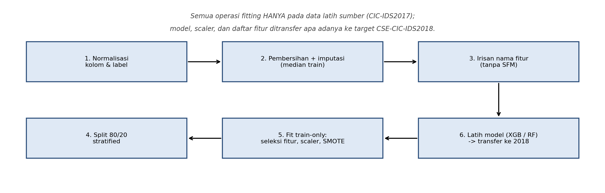
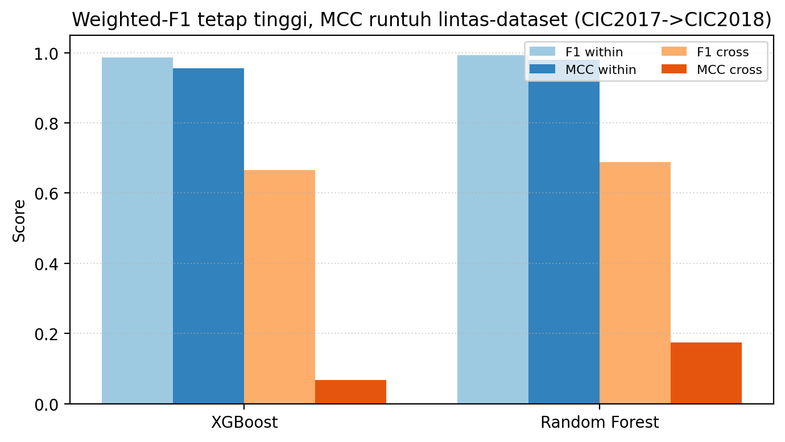
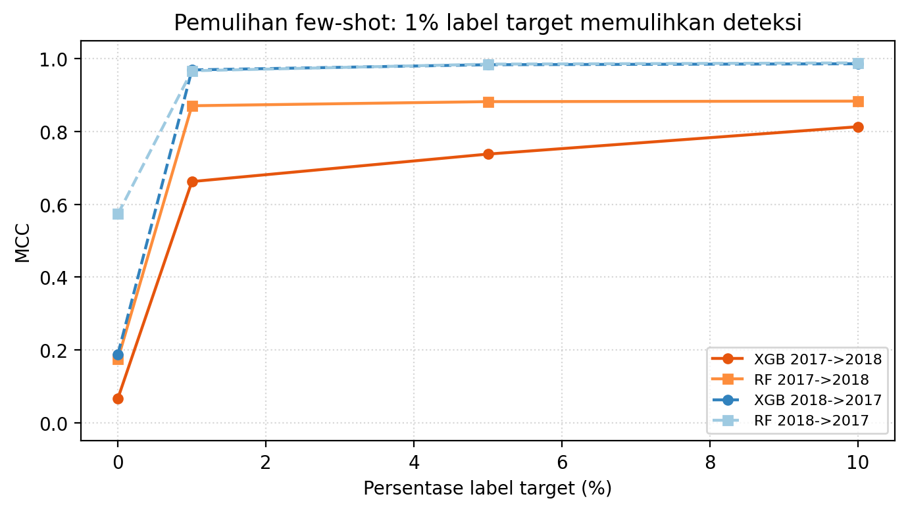
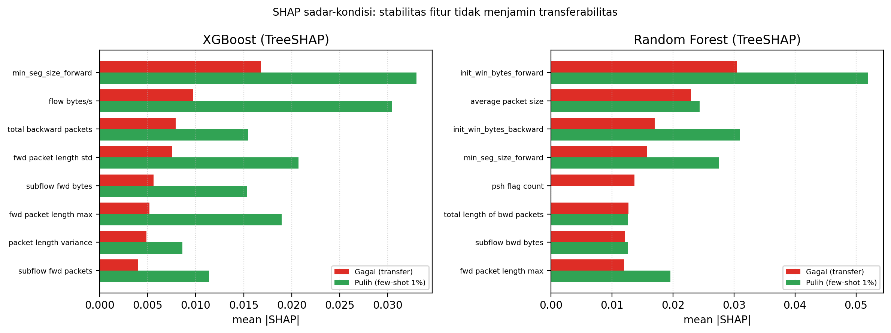

<!-- ============================================================
PAPER 4 - XAI untuk NIDS (versi kerangka / draft Bahasa Indonesia)
Format & urutan mengikuti jurnal JICTRA.
STATUS: ANGKA TERISI dari hasil eksperimen notebook `notebook_xai/` (01-03) di
        AWS SageMaker, data CIC-IDS2017 (MachineLearningCSV, mentah) -> CSE-CIC-IDS2018.
        Semua angka nyata (bukan dikarang). Teks naratif boleh dirapikan lebih lanjut.
Prinsip: tanpa Semantic Feature Mapping (SFM). Semua angka harus jujur
        dari eksperimen nyata.
Dataset: CIC-IDS2017 (referensi/latih) -> CSE-CIC-IDS2018 (target transfer),
        keduanya CICFlowMeter. Arah utama 2017 -> 2018 (replikasi langsung paper
        referensi JTIIK); arah balik 2018 -> 2017 dihitung sebagai penguat.
Komputasi: seluruh notebook dieksekusi di AWS SageMaker (lihat notebook_xai/ & aws_xai/).
============================================================ -->

# Explainable AI untuk Network Intrusion Detection System: Diagnosis dan Pemulihan Kegagalan Generalisasi Lintas-Dataset pada Pipeline Bebas-Kebocoran

> Catatan draft: judul dapat diringkas. Alternatif:
> "Mengurai Kegagalan Generalisasi NIDS Lintas-Dataset: Pipeline Bebas-Kebocoran,
> Kalibrasi Ambang, dan Interpretasi SHAP yang Sadar-Kondisi".

**Penulis Pertama¹, Penulis Kedua², Penulis Ketiga³**
¹²³ Departemen Teknik Informatika dan Komputer, Politeknik Elektronika Negeri Surabaya (PENS), Surabaya, Indonesia
Email: penulis1@pens.ac.id; penulis2@pens.ac.id; penulis3@pens.ac.id
*Penulis Korespondensi

---

## Abstrak

<!-- Target JICTRA: 100-200 kata, satu paragraf, Bahasa Indonesia. -->

Sistem deteksi intrusi jaringan (NIDS) berbasis pembelajaran mesin kerap menunjukkan
performa nyaris sempurna pada evaluasi within-dataset, namun runtuh ketika diuji pada
dataset dengan distribusi dan komposisi serangan berbeda. Penelitian ini menyajikan
diagnosis dan pemulihan kegagalan generalisasi lintas-dataset menggunakan pipeline
bebas-kebocoran pada CIC-IDS2017 sebagai dataset referensi dan CSE-CIC-IDS2018 sebagai
dataset target, keduanya diekstraksi dengan CICFlowMeter. Dua model dibandingkan, XGBoost
dan Random Forest, dilatih hanya pada data referensi lalu ditransfer ke target tanpa
pelatihan ulang. Pada evaluasi within-dataset, kedua model mencapai performa tinggi (XGBoost MCC 0,955,
F1 0,986, AUC-ROC 0,999; Random Forest MCC 0,979, F1 0,993, AUC-ROC 1,000). Pada
evaluasi lintas-dataset CIC-IDS2017 ke CSE-CIC-IDS2018, MCC pada ambang 0,5 runtuh
menjadi 0,067 (XGBoost) dan 0,175 (Random Forest) dengan recall kelas serangan mendekati
nol, walau weighted-F1 tetap tampak tinggi (0,665 dan 0,687), yang menunjukkan bahwa
weighted-F1 dan akurasi menyesatkan pada data tidak seimbang. Berbeda dengan studi
terdahulu yang berhenti pada diagnosis, penelitian ini (i) memisahkan kegagalan ranking
dari kegagalan ambang: AUC-ROC lintas-dataset tetap di atas acak (0,779 pada XGBoost)
dan kalibrasi ambang mengangkat MCC ke 0,498, sedangkan untuk Random Forest kalibrasi
hanya mencapai 0,403; serta (ii) memulihkan deteksi melalui kalibrasi few-shot minimal
sehingga dengan hanya 1% label target MCC naik menjadi 0,663 (XGBoost) dan 0,871 (Random
Forest) pada arah 2017 ke 2018, dan di atas 0,96 pada arah sebaliknya. Analisis SHAP ditafsirkan secara sadar-kondisi: interpretasi pada model yang gagal
berbeda makna dengan model yang telah pulih. Temuan menegaskan pentingnya pelaporan MCC,
recall per-kelas, kalibrasi ambang, dan validasi lintas-dataset.

**Kata kunci:** explainable AI; deteksi intrusi jaringan; generalisasi lintas-dataset;
kalibrasi ambang; SHAP; MCC.

---

## Abstract

<!-- Versi Inggris dari abstrak, isi menyusul setelah versi Indonesia final. -->

Machine-learning network intrusion detection systems (NIDS) often appear nearly perfect
under within-dataset evaluation yet collapse on datasets with different attack compositions
and recording conditions. This paper presents a diagnosis and repair of cross-dataset
generalization failure using a leakage-free pipeline, with CIC-IDS2017 as the reference
dataset and CSE-CIC-IDS2018 as the transfer target, both extracted with CICFlowMeter and
aligned by feature-name intersection only (no semantic feature mapping). Two classifiers,
XGBoost and Random Forest, are trained on the reference and transferred to the target
without retraining. Within-dataset performance is high (Matthews correlation coefficient,
MCC, of 0.955 and 0.979). Across datasets, MCC at the default threshold collapses to 0.067
and 0.175 with near-zero attack recall, while weighted-F1 remains misleadingly high. Unlike
prior work that stops at diagnosis, we (i) separate ranking failure from thresholding
failure: cross-dataset AUC stays above chance (0.779 for XGBoost) and threshold calibration
lifts MCC to 0.498, whereas for Random Forest calibration reaches only 0.403; and (ii)
repair detection with minimal few-shot calibration, where only 1% of target labels raises
MCC to 0.663 (XGBoost) and 0.871 (Random Forest), and above 0.96 in the reverse direction.
SHAP is read in a condition-aware manner: feature-ranking stability (Spearman 0.72 between
failed and repaired models) does not imply transferability. The findings reinforce reporting
MCC, per-class recall, threshold calibration, and cross-dataset validation in NIDS research.

**Keywords:** explainable AI; network intrusion detection; cross-dataset generalization;
threshold calibration; SHAP; MCC.

---

## 1. Pendahuluan

<!-- Isi: latar belakang, gap, kontribusi. Gaya sitasi JICTRA: nama-tahun. -->

Transformasi digital memperluas permukaan serangan jaringan dan meningkatkan kebutuhan
terhadap NIDS yang andal. Pendekatan pembelajaran mesin banyak dipakai karena mampu
mempelajari pola trafik dari dataset benchmark seperti CIC-IDS2017 dan CSE-CIC-IDS2018.
Namun, performa tinggi pada evaluasi within-dataset tidak menjamin keandalan operasional
pada lingkungan yang berbeda (D'hooge dkk., 2020; Cantone dkk., 2024). Layeghy dan Portmann
(2023) menunjukkan bahwa model NIDS yang nyaris sempurna pada tolok ukur sintetis sering
tidak tergeneralisasi ke jaringan lain, karena perbedaan infrastruktur dan protokol
menghasilkan pergeseran distribusi fitur (covariate maupun concept shift). Tinjauan
transfer learning untuk IDS (Kheddar dkk., 2023) menegaskan bahwa adaptasi domain menjadi
kebutuhan ketika label pada domain target langka.

Dua persoalan metodologis menonjol. **Pertama, kebocoran data (data leakage)** muncul bila
seleksi fitur, standardisasi, atau oversampling dilakukan sebelum pemisahan latih-uji,
menghasilkan estimasi performa yang terlalu optimistis. **Kedua, kesesuaian skema fitur
tidak menjamin kesesuaian distribusi**: meskipun nama dan jumlah fitur cocok (karena alat
ekstraksi sama, yaitu CICFlowMeter), nilai statistik fitur dapat berbeda akibat perbedaan
komposisi serangan dan kondisi perekaman. Karena itu, evaluasi lintas-dataset yang kredibel
menuntut pipeline yang sadar-kebocoran dan, idealnya, analisis transfer dua arah agar
keandalan model tidak dinilai dari satu arah saja.

Studi pendahulu oleh tim penulis (Martono dkk., 2024; dan manuskrip XAI-IDS pada pipeline
bebas-kebocoran) telah menunjukkan fenomena runtuhnya MCC pada evaluasi lintas-dataset,
tetapi memiliki tiga keterbatasan yang menjadi celah penelitian ini:
1. **Berhenti pada diagnosis** — menyatakan model gagal tanpa menawarkan pemulihan.
2. **Mencampur dua jenis kegagalan** — menafsirkan MCC = 0 murni sebagai pergeseran
   distribusi, padahal AUC yang bervariasi mengindikasikan sebagian adalah masalah
   kalibrasi ambang.
3. **Interpretasi SHAP tanpa konteks kondisi model** — menghitung SHAP pada model yang
   recall serangannya nol, sehingga interpretasinya rapuh.

Untuk menutup keterbatasan tersebut, penelitian ini menyumbang sebuah pipeline
bebas-kebocoran untuk eksperimen IDS biner lintas-dataset antara CIC-IDS2017 dan
CSE-CIC-IDS2018 (dua arah) yang menyelaraskan fitur melalui irisan nama tanpa pemetaan
fitur semantik. Di atas pipeline ini kami memisahkan kegagalan ranking (diukur AUC/PR-AUC)
dari kegagalan ambang (MCC pada ambang baku) lalu menerapkan kalibrasi ambang; berbeda dari
adaptasi domain berbasis jaringan dalam seperti DI-NIDS/DANN (Layeghy dkk., 2023) yang
menuntut tumpukan deep dan data target melimpah, perbaikan kami berupa kalibrasi few-shot
ringan yang hanya memakai sebagian kecil label target dan dilaporkan dengan selang
kepercayaan multi-seed. Kami juga membandingkan XGBoost dan Random Forest pada protokol
identik untuk menguji apakah pola kegagalan-lalu-pemulihan bersifat umum lintas-algoritma,
serta menafsirkan model dengan analisis SHAP sadar-kondisi yang membandingkan model gagal
dan model pulih untuk kedua algoritma, yang memperlihatkan bahwa stabilitas peringkat fitur
tidak dengan sendirinya menjamin transferabilitas lintas-dataset.

---

## 2. Metode Penelitian

### 2.1 Dataset dan Ruang Lingkup Eksperimen

Eksperimen menggunakan dua dataset benchmark yang keduanya diekstraksi dengan CICFlowMeter:
- **CIC-IDS2017** — dataset referensi (latih). Serangan campuran (brute force, DoS, DDoS,
  web attack, infiltrasi, botnet, port scan).
- **CSE-CIC-IDS2018** — dataset target lintas. Komposisi serangan dan kondisi perekaman
  berbeda dari 2017 meskipun alat ekstraksi fitur sama (CICFlowMeter).

Pemilihan pasangan 2017 → 2018 mengikuti protokol paper referensi sehingga perbandingan
bersifat apple-to-apple. Seluruh label dipetakan ke skema biner: Benign/Normal = 0,
Attack = 1. Untuk mengendalikan beban komputasi, tiap dataset diproses dengan stratified
subsampling maksimal 100.000 baris per file sumber CICFlowMeter. Ringkasan data setelah pembersihan dan pembagian
pada Tabel 1.

**Tabel 1. Ringkasan dataset setelah pra-pemrosesan dan subsampling**

| Dataset | Sampel (stratified) | Train (80%) | Test (20%) | Fitur irisan | %Attack |
|---|---|---|---|---|---|
| CIC-IDS2017 (ref) | 799.989 | 639.991 | 159.998 | 76 | 19,26 |
| CSE-CIC-IDS2018 (target) | 999.987 | 799.989 | 199.998 | 76 | 23,83 |

### 2.2 Pipeline Bebas-Kebocoran

Seluruh operasi fitting hanya menggunakan data latih. Urutan pemrosesan:
1. **Normalisasi kolom dan label** — pembersihan whitespace/BOM pada nama kolom,
   penyeragaman nama antar rilis CICFlowMeter, normalisasi label (mis. hapus prefiks
   `DrDoS_`, kapitalisasi seragam), pemetaan ke biner.
2. **Pembersihan data** — buang kolom metadata (IP, port, protocol, timestamp, flow id),
   hapus duplikasi, ubah nilai tak hingga menjadi NaN, buang kolom missing dominan, isi
   sisa missing numerik dengan median (statistik median dari **train**).
3. **Penyelarasan skema fitur (tanpa SFM)** — ambil **irisan nama kolom** antara kedua
   dataset setelah normalisasi; tidak ada pemetaan semantik manual, tidak ada pengisian-nol
   untuk fitur yang tak ada. (Varian pengisian-nol diuji sebagai ablation, lihat 3.x.)
4. **Pembagian data** — stratified split 80% latih / 20% uji.
5. **Seleksi fitur, standardisasi, SMOTE — hanya pada data latih.** Seleksi fitur top-k
   dari importance model di data latih; StandardScaler fit di latih; SMOTE hanya di latih.

Pada evaluasi lintas-dataset, model, scaler, dan daftar fitur hasil seleksi dari referensi
(CIC-IDS2017) dipakai langsung pada target (CSE-CIC-IDS2018). Evaluasi mengukur kemampuan
**transfer**, bukan adaptasi ulang.

Seluruh notebook eksperimen (`notebook_xai/01–03`) dieksekusi di **AWS SageMaker**: dataset
mentah di-sync dari S3, notebook dijalankan berurutan, dan artefak hasil (JSON) di-upload
kembali ke S3 untuk mengisi tabel-tabel pada bagian Hasil.

*Gambar 1. Pipeline evaluasi lintas-dataset bebas-kebocoran. Seluruh fitting (imputasi
median, seleksi fitur, standardisasi, SMOTE) hanya memakai data latih sumber; model,
scaler, dan daftar fitur lalu ditransfer apa adanya ke dataset target.*

### 2.3 Model Klasifikasi

Kami sengaja memakai dua model ensembel pohon, bukan jaringan dalam. Ensembel pohon tetap
menjadi baseline kuat dan lazim untuk fitur flow tabular pada NIDS; model ini cepat dilatih,
ringan untuk deployment edge/sumber daya terbatas, dan — penting bagi penelitian ini —
mendukung atribusi eksak dan cepat melalui TreeSHAP yang menjadi dasar analisis SHAP
sadar-kondisi di Bagian 3.

Kedua model mewakili dua paradigma pembelajaran yang saling melengkapi. **Random Forest**
adalah ensembel *bagging*: menumbuhkan banyak pohon ter-dekorelasi pada sampel bootstrap lalu
merata-ratakan suara, sehingga menekan varians dan sejajar dengan paper referensi.
**XGBoost** adalah ensembel *gradient boosting*: menambahkan pohon secara berurutan, tiap
pohon mengoreksi galat sisa pohon sebelumnya, mewakili keluarga gradient boosting yang umum
pada IDS modern. Membandingkan model bagging dan boosting memungkinkan kami menguji apakah
pola kegagalan-lalu-pemulihan bersifat khas satu gaya belajar atau umum pada keduanya.

Kedua model dijalankan pada pipeline bebas-kebocoran, subset fitur terpilih, dan pembagian
latih/uji yang **sama**, sehingga perbedaan yang teramati mencerminkan algoritma, bukan
pra-pemrosesan. XGBoost memakai max_depth=8, learning_rate=0,1, n_estimators=200,
subsample=colsample_bytree=0,8; Random Forest memakai n_estimators=200 dengan max_depth=20.
Kedalaman Random Forest dibatasi 20 agar pelatihan tetap praktis pada data referensi yang
lebih besar (~800 ribu baris); dampaknya pada akurasi kecil dan dilaporkan sebagai pilihan
metodologis. Pada notebook SHAP, XGBoost menambahkan base_score=0,5 demi kompatibilitas
pustaka interpretasi; ini tidak memengaruhi metrik performa. Pengaturan lain dibiarkan pada
nilai baku pustaka, dan lima seed acak yang sama dipakai di seluruh eksperimen. Detail
lengkap di notebook `notebook_xai/`.

### 2.4 Metrik Evaluasi

Metrik: accuracy, precision, recall (per-kelas), weighted F1, AUC-ROC, **PR-AUC**, dan
**MCC**. MCC diprioritaskan pada evaluasi lintas-dataset karena memperhitungkan TP/TN/FP/FN
secara simultan dan tetap informatif pada data tidak seimbang (Chicco & Jurman, 2020).
Untuk memisahkan kegagalan ranking dari kegagalan ambang, dilaporkan **AUC/PR-AUC**
(independen ambang) bersama **MCC dan recall Attack pada ambang 0,5 dan ambang terkalibrasi**.

### 2.5 Kalibrasi Ambang dan Pemulihan Few-Shot

- **Kalibrasi ambang**: ambang keputusan dipilih ulang pada target (mis. maksimasi MCC /
  Youden's J pada subset kecil), untuk menguji apakah "kegagalan" sebagian hanya artefak
  ambang 0,5.
- **Pemulihan few-shot**: tambahkan fraksi kecil label target (0%, 1%, 5%, 10%) ke
  pelatihan lalu ukur kenaikan MCC & recall Attack.

### 2.6 Explainability dengan SHAP

SHAP (TreeSHAP untuk model berbasis pohon) dipakai untuk kepentingan fitur global pada
tiap arah transfer. Fitur diberi peringkat berdasarkan mean absolute SHAP; stabilitas
dihitung dari rata-rata dan standar deviasi peringkat antar-kondisi; korelasi Spearman
mengukur kesamaan peringkat antar-arah. **Interpretasi sadar-kondisi:** SHAP dihitung pada
(a) model gagal (sebelum pemulihan) dan (b) model pulih (sesudah few-shot), lalu
dibandingkan — untuk menegaskan bahwa stabilitas fitur tidak identik dengan transferabilitas.

---

## 3. Hasil dan Pembahasan

### 3.1 Kinerja Within-Dataset

Pada evaluasi within-dataset (CIC-IDS2017), kedua model mencapai performa tinggi.
Skor ini tidak boleh ditafsirkan sebagai kesiapan operasional lintas lingkungan.

**Tabel 2. Kinerja within-dataset (mean multi-seed)**

| Metrik | XGBoost | Random Forest |
|---|---|---|
| F1 (weighted) | 0,986 | 0,993 |
| MCC | 0,955 | 0,979 |
| AUC-ROC | 0,999 | 1,000 |
| Recall Attack | 0,939 | 0,998 |

*Mean 5 seed {42, 1, 7, 123, 2024}, evaluasi within CIC-IDS2017 (test 20%).*

### 3.2 Generalisasi Lintas-Dataset (CIC2017 → CIC2018 dan sebaliknya)

**Tabel 3. Evaluasi lintas-dataset (transfer langsung, ambang 0,5, mean multi-seed)**

| Model | Arah | Tipe | F1 | MCC | AUC | PR-AUC | Recall Attack |
|---|---|---|---|---|---|---|---|
| XGBoost | CIC2017 | Within | 0,986 | 0,955 | 0,999 | - | 0,939 |
| XGBoost | CIC2017 → CIC2018 | Cross | 0,665 | 0,067 | 0,779 | 0,619 | 0,013 |
| XGBoost | CIC2018 → CIC2017 | Cross | 0,759 | 0,188 | 0,684 | 0,391 | 0,119 |
| RF | CIC2017 | Within | 0,993 | 0,979 | 1,000 | - | 0,998 |
| RF | CIC2017 → CIC2018 | Cross | 0,687 | 0,175 | 0,573 | 0,456 | 0,056 |
| RF | CIC2018 → CIC2017 | Cross | 0,868 | 0,574 | 0,863 | 0,676 | 0,474 |

<!-- Fenomena yang diharapkan (hipotesis, konfirmasi via eksperimen): MCC runtuh pada
     cross walau weighted-F1 tampak tinggi; recall Attack mendekati 0 pada ambang 0,5. -->

### 3.3 Diskrepansi Weighted-F1 vs MCC

Pada arah CIC2017 ke CIC2018, weighted-F1 tetap tampak tinggi (0,665 pada XGBoost dan
0,687 pada Random Forest) padahal MCC runtuh ke 0,067 dan 0,175 serta recall kelas
serangan hanya 0,013 dan 0,056. Artinya model lulus "akurasi" dengan memprediksi hampir
semua flow sebagai kelas benign yang dominan, sementara nyaris tidak mendeteksi serangan.
Implikasi: metrik tunggal weighted-F1 atau akurasi tidak memadai untuk IDS lintas-dataset;
MCC dan recall per-kelas wajib dilaporkan.

*Gambar 2. Perbandingan weighted-F1 dan MCC, within-dataset versus lintas-dataset, untuk
kedua model. Weighted-F1 mengikuti kelas benign dominan, sedangkan MCC menyingkap
kegagalan memisahkan benign dari serangan lintas-dataset.*

### 3.4 Ranking vs Ambang: Kalibrasi Ambang (KONTRIBUSI BARU)

Temuan kunci: kegagalan lintas-dataset tidak seragam jenisnya. Pada XGBoost arah CIC2017
ke CIC2018, AUC-ROC tetap 0,779 (jauh di atas acak 0,5) walau MCC@0,5 hanya 0,067; setelah
ambang keputusan dikalibrasi pada subset target kecil, MCC naik ke 0,498. Ini menunjukkan
model sebenarnya masih mampu me-ranking serangan di atas benign, dan sebagian besar
"kegagalan" adalah artefak ambang 0,5 yang tidak lagi sesuai di domain target. Sebaliknya,
pada Random Forest arah yang sama AUC hanya 0,573 (mendekati acak) sehingga kalibrasi
ambang hanya mengangkat MCC ke 0,403 — di sini kegagalan lebih bersifat kegagalan ranking,
bukan sekadar ambang. Jadi kalibrasi ambang membantu bila kemampuan ranking masih
terpelihara, dan kurang membantu bila ranking itu sendiri sudah rusak.

**Tabel 4. Efek kalibrasi ambang pada target**

| Model | Arah | MCC@0,5 | MCC@ambang-terkalibrasi |
|---|---|---|---|
| XGBoost | CIC2017 → CIC2018 | 0,067 | 0,498 |
| XGBoost | CIC2018 → CIC2017 | 0,188 | 0,362 |
| RF | CIC2017 → CIC2018 | 0,175 | 0,403 |
| RF | CIC2018 → CIC2017 | 0,574 | 0,633 |

*Ambang dipilih memaksimalkan MCC pada subset kalibrasi kecil (10% test target); mean 5 seed.*

### 3.5 Pemulihan via Few-Shot (KONTRIBUSI BARU)

Penambahan hanya 1% label target memulihkan deteksi secara dramatis. Pada arah CIC2017 ke
CIC2018, MCC naik dari 0,067 ke 0,663 (XGBoost) dan dari 0,175 ke 0,871 (Random Forest);
pada arah sebaliknya, dari 0,188 ke 0,969 (XGBoost) dan dari 0,574 ke 0,967 (Random
Forest). Menambah anggaran label ke 5% dan 10% memberi perbaikan yang semakin mengecil
(mis. XGBoost 2017 ke 2018: 0,738 lalu 0,813). Pemulihan konsisten di kedua arah dan kedua
model, menandakan adaptasi domain berbiaya rendah adalah jalur praktis yang umum, bukan
kebetulan satu konfigurasi.

**Tabel 5. Pemulihan few-shot (MCC per fraksi label target, mean±CI95 multi-seed)**

| Model | Arah | 0% | 1% | 5% | 10% |
|---|---|---|---|---|---|
| XGBoost | CIC2017 → CIC2018 | 0,067 | 0,663 | 0,738 | 0,813 |
| XGBoost | CIC2018 → CIC2017 | 0,188 | 0,969 | 0,984 | 0,986 |
| RF | CIC2017 → CIC2018 | 0,175 | 0,871 | 0,882 | 0,884 |
| RF | CIC2018 → CIC2017 | 0,574 | 0,967 | 0,985 | 0,989 |

*MCC, mean 5 seed. Fraksi = porsi label target yang ditambahkan ke pelatihan.*

*Gambar 3. Kurva pemulihan few-shot (MCC vs persentase label target) untuk kedua model
dan kedua arah transfer. Bahkan 1% label target memulihkan sebagian besar performa.*

### 3.6 Perbandingan XGBoost vs Random Forest

Kedua model dijalankan pada pipeline dan protokol identik. Perbandingan ini menguji apakah
fenomena kegagalan generalisasi dan pola pemulihan bersifat umum (lintas algoritma) atau
spesifik pada satu model.

**Tabel 6. Perbandingan XGBoost vs Random Forest (mean multi-seed)**

| Metrik | XGBoost | Random Forest |
|---|---|---|
| Within CIC2017 MCC | 0,955 | 0,979 |
| Cross CIC2017→CIC2018 MCC@0,5 | 0,067 | 0,175 |
| Cross CIC2017→CIC2018 AUC | 0,779 | 0,573 |
| Cross MCC@ambang-terkalibrasi | 0,498 | 0,403 |
| Few-shot 1% CIC2017→CIC2018 MCC | 0,663 | 0,871 |
| Cross CIC2018→CIC2017 MCC@0,5 | 0,188 | 0,574 |
| Few-shot 1% CIC2018→CIC2017 MCC | 0,969 | 0,967 |

Kedua model sama-sama runtuh pada ambang 0,5 di arah CIC2017 ke CIC2018 (MCC 0,067 dan
0,175), sehingga fenomena collapse bukan khas satu algoritma. Perbedaannya pada sifat
kegagalan: XGBoost mempertahankan kemampuan ranking lebih baik (AUC 0,779 vs 0,573),
sehingga lebih diuntungkan kalibrasi ambang (0,498 vs 0,403). Random Forest justru lebih
tahan transfer pada arah CIC2018 ke CIC2017 (MCC@0,5 0,574 vs 0,188). Pemulihan few-shot
efektif pada keduanya (semua mencapai 0,66 hingga 0,99 pada 1% label). Kesimpulan: pola
kegagalan lalu pemulihan bersifat umum lintas algoritma, sedangkan sifat kegagalan
(ranking versus ambang) dan arah yang lebih mudah ditransfer bergantung pada algoritma.

### 3.7 Stabilitas Fitur SHAP yang Sadar-Kondisi

**Tabel 7. Sepuluh fitur terpenting berdasarkan SHAP (per model, model gagal vs pulih)**

| Model | Kondisi | Fitur Top-5 (urut mean|SHAP|) |
|---|---|---|
| XGBoost | Gagal (transfer) | min_seg_size_forward; flow bytes/s; total backward packets; fwd packet length std; subflow fwd bytes |
| XGBoost | Pulih (few-shot 1%) | min_seg_size_forward; flow bytes/s; max packet length; fwd packet length std; fwd packet length max |
| RF | Gagal (transfer) | init_win_bytes_forward; average packet size; init_win_bytes_backward; min_seg_size_forward; psh flag count |
| RF | Pulih (few-shot 1%) | init_win_bytes_forward; init_win_bytes_backward; min_seg_size_forward; average packet size; fwd header length |

Peringkat fitur SHAP relatif stabil antara model gagal dan model pulih (korelasi Spearman
0,721, p=0,001 untuk XGBoost; 0,723, p=0,001 untuk Random Forest): sebagian besar fitur
teratas tetap sama. Namun kesamaan peringkat antar-model justru rendah (Spearman 0,20,
p=0,56 pada model gagal), menandakan XGBoost dan Random Forest menimbang fitur secara
berbeda. Yang penting, stabilitas ranking tidak menjamin transferabilitas: model gagal
(MCC lintas-dataset mendekati nol) dan model pulih (few-shot) sebagian besar bertumpu pada
fitur yang sama, padahal kinerja deteksinya berbeda jauh. Dengan kata lain, interpretasi
SHAP harus dibaca sadar-kondisi — fitur "penting" pada model yang gagal mendeteksi serangan
tidak otomatis bermakna operasional, dan juga sadar-model karena dua algoritma memberi
peringkat berbeda.

*Gambar 4. Kepentingan fitur SHAP sadar-kondisi (model gagal versus pulih) untuk XGBoost
dan Random Forest. Stabilitas peringkat fitur antar-kondisi tidak berujung pada
transferabilitas lintas-dataset.*

### 3.8 Analisis Pergeseran Distribusi (opsional, penguat)

Catatan: kuantifikasi langsung pergeseran distribusi antar-dataset (mis. jarak Wasserstein
per fitur atau akurasi domain-classifier) tidak dihitung pada eksperimen ini dan
disediakan sebagai arah penguat pada pekerjaan lanjutan. Bukti tidak-langsung pergeseran
sudah tampak dari kontras tajam antara performa within-dataset (MCC 0,955 hingga 0,979)
dan lintas-dataset (MCC mendekati nol pada ambang 0,5), serta dari berubahnya ambang
optimal pada domain target.

### 3.9 Multi-Seed dan Interval Kepercayaan

Seluruh angka utama dilaporkan sebagai rerata atas 5 seed {42, 1, 7, 123, 2024} dengan
selang kepercayaan 95% (distribusi-t, df=4). Sebagai contoh lebar selang: within CIC2017
MCC XGBoost 0,955 [0,940, 0,970] dan Random Forest 0,979 [0,971, 0,988]; lintas CIC2017 ke
CIC2018 MCC@0,5 XGBoost 0,067 [0,012, 0,122]. Selang few-shot pada 1% label lebih lebar
pada XGBoost arah 2017 ke 2018 (0,663 [0,414, 0,911]) namun sempit pada Random Forest arah
sebaliknya (0,967 [0,963, 0,971]), menunjukkan variabilitas antar-seed yang jujur
dilaporkan, bukan hasil run tunggal.

### 3.10 Implikasi terhadap Riset dan Operasional IDS

- Evaluasi within-dataset tidak cukup menilai kelayakan IDS.
- MCC, PR-AUC, recall Attack, dan kalibrasi ambang wajib dilaporkan.
- SHAP harus dibaca bersama kondisi model.
- Pemulihan few-shot menunjukkan jalur praktis adaptasi domain berbiaya rendah.

### 3.11 Keterbatasan

Penelitian ini memiliki beberapa keterbatasan. (i) Klasifikasi dibatasi biner
(benign vs attack); perilaku per-kategori serangan tidak dianalisis. (ii) Cakupan hanya
dua dataset (CIC-IDS2017 dan CSE-CIC-IDS2018) yang keduanya dari CICFlowMeter, sehingga
generalisasi ke ekstraktor atau jaringan lain belum diuji. (iii) Tiap file sumber dibatasi
100.000 baris (stratified) untuk mengendalikan beban komputasi, sehingga bukan populasi
penuh. (iv) Penyetelan XGBoost memakai base_score=0,5 eksplisit pada notebook SHAP agar
kompatibel dengan pustaka interpretasi; perbedaan setelan ini tidak memengaruhi metrik
performa. (v) Interpretasi difokuskan pada SHAP global (mean absolut); analisis lokal
per-instans dan kuantifikasi pergeseran distribusi diserahkan ke pekerjaan lanjutan.

### 3.12 Perbandingan dengan Karya Pendahulu

Penelitian ini merupakan kelanjutan langsung dari manuskrip pendahulu tim penulis
(Martono dkk., 2024) yang mendiagnosis fenomena runtuhnya generalisasi lintas-dataset.
Perbandingan eksplisit pada Tabel 8 menegaskan apa yang ditambahkan karya ini.

**Tabel 8. Posisi terhadap karya pendahulu**

| Aspek | Karya pendahulu (JTIIK) | Penelitian ini |
|---|---|---|
| Penyelarasan fitur | Harmonisasi 75 fitur dengan **pengisian-nol** untuk fitur yang tak ada | **Irisan nama** 76 fitur, tanpa pengisian-nol |
| Model | Random Forest (model referensi) | XGBoost **dan** Random Forest (protokol identik) |
| Cross MCC@0,5 (2017→2018) | **0,00 pada seluruh 10 partisi** (recall serangan 0) | 0,067 (XGB) / 0,175 (RF) — runtuh namun tak nol-mutlak |
| AUC lintas-dataset | Rerata ~0,46 (≈acak) | 0,779 (XGB) — di atas acak |
| Jenis kegagalan | Ditafsir murni pergeseran distribusi | **Dipisah**: ranking vs ambang |
| Pemulihan | Tidak ada (berhenti pada diagnosis) | **Kalibrasi ambang + few-shot 1%** (MCC hingga 0,66–0,99) |
| Arah transfer | Satu arah (2017→2018) | **Dua arah** (2017↔2018) |
| SHAP | Dihitung pada model gagal saja | **Sadar-kondisi** (gagal vs pulih) + antar-model |

Perbedaan angka cross yang paling mencolok — MCC 0,00 dan AUC acak pada karya pendahulu
versus MCC kecil-tetapi-positif dengan AUC 0,779 di sini — kemungkinan besar berakar pada
strategi penyelarasan fitur. Pengisian-nol untuk fitur yang hilang pada karya pendahulu
menyuntikkan kolom konstan yang dapat merusak batas keputusan dan menyamarkan kemampuan
ranking model; pendekatan irisan-nama murni pada penelitian ini menghindari artefak
tersebut, sehingga terungkap bahwa sebagian "kegagalan" sesungguhnya adalah masalah ambang
yang dapat dipulihkan. Dengan demikian, penelitian ini bukan sekadar mereproduksi temuan
pendahulu, melainkan mengoreksi interpretasinya dan menuntaskan jalur pemulihan yang pada
karya pendahulu hanya disarankan sebagai kerja mendatang.

---

---

## 4. Kesimpulan

<!-- Ringkas: diagnosis + koreksi (ranking vs ambang) + pemulihan few-shot + SHAP sadar
     kondisi. Angka sudah terisi dari eksperimen. -->

Penelitian ini menyajikan diagnosis dan pemulihan kegagalan generalisasi lintas-dataset
pada NIDS dengan pipeline bebas-kebocoran, tanpa pemetaan fitur semantik, menggunakan
CIC-IDS2017 (referensi) dan CSE-CIC-IDS2018 (target). Model referensi mencapai performa
within-dataset tinggi (MCC 0,955 pada XGBoost dan 0,979 pada Random Forest) namun runtuh
pada transfer lintas-dataset CIC2017 ke CIC2018 (MCC pada ambang 0,5 menjadi 0,067 dan
0,175, recall serangan mendekati nol). Berbeda dari studi terdahulu, penelitian ini
memisahkan kegagalan ranking dari kegagalan ambang — kalibrasi ambang mengangkat MCC
XGBoost ke 0,498 (AUC 0,779) sedangkan Random Forest hanya ke 0,403 (AUC 0,573) — dan
memulihkan deteksi melalui kalibrasi few-shot minimal, dengan 1% label target menaikkan
MCC ke 0,663 hingga 0,969 bergantung model dan arah. Analisis SHAP sadar-kondisi (Spearman
gagal-vs-pulih 0,72, namun antar-model hanya 0,20) menegaskan bahwa stabilitas peringkat
fitur tidak menjamin transferabilitas. Penelitian lanjutan: kuantifikasi pergeseran
distribusi, skenario lebih berat (mis. CIC-DDoS2019), klasifikasi multi-kelas, dan
validasi trafik nyata.

---

## Ucapan Terima Kasih

Penulis mengucapkan terima kasih kepada Politeknik Elektronika Negeri Surabaya (PENS)
atas dukungan, dan kepada mitra AWS atas sumber daya komputasi cloud yang dipakai dalam
eksperimen ini.

---

## Daftar Pustaka

<!-- Gaya nama-tahun (Harvard). Semua entri tervalidasi: dipakai pada manuskrip
     pendahulu tim penulis (JTIIK) dan paper NIDS lintas-jaringan penulis (JICTRA).
     Verifikasi akhir DOI/halaman dilakukan saat penyiapan kamera-siap. -->

ALABBAADI, A. dan BAJABER, F., 2025. IDS over IoT data streams using explainable AI.
*Sensors*, 25(3), 847.

ARRECHE, O., GUNTUR, T.R., ROBERTS, J.W. dan ABDALLAH, M., 2024. XAI-IDS: Toward an
explainable AI framework for network intrusion detection systems. *Applied Sciences*,
14(10), 4170.

BREIMAN, L., 2001. Random forests. *Machine Learning*, 45(1), pp. 5-32.

BUCZAK, A.L. dan GUVEN, E., 2016. A survey of data mining and machine learning methods for
cyber security intrusion detection. *IEEE Communications Surveys and Tutorials*, 18(2),
pp. 1153-1176.

CANTONE, M., MARROCCO, C. dan BRIA, A., 2024. Machine learning in network intrusion
detection: A cross-dataset generalization study. *IEEE Access*, 12, pp. 144491-144509.

CATILLO, M., PECCHIA, A. dan VILLANO, U., 2023. Machine learning on public intrusion
datasets: Academic hype or concrete advances in NIDS? *Proc. 53rd IEEE/IFIP Int. Conf.
Dependable Systems and Networks (DSN-S)*, pp. 132-136.

CHAWLA, N.V., BOWYER, K.W., HALL, L.O. dan KEGELMEYER, W.P., 2002. SMOTE: Synthetic
minority over-sampling technique. *Journal of Artificial Intelligence Research*, 16,
pp. 321-357.

CHEN, T. dan GUESTRIN, C., 2016. XGBoost: A scalable tree boosting system. *Proc. 22nd
ACM SIGKDD Int. Conf. Knowledge Discovery and Data Mining*, pp. 785-794.

CHICCO, D. dan JURMAN, G., 2020. The advantages of the Matthews correlation coefficient
(MCC) over F1 score and accuracy in binary classification evaluation. *BMC Genomics*,
21(1), 6.

D'HOOGE, L., WAUTERS, T., VOLCKAERT, B. dan DE TURCK, F., 2020. Inter-dataset
generalization strength of supervised machine learning methods for intrusion detection.
*Journal of Information Security and Applications*, 54, 102564.

ENGELEN, G., RIMMER, V. dan JOOSEN, W., 2021. Troubleshooting an intrusion detection
dataset: The CICIDS2017 case study. *Proc. IEEE Security and Privacy Workshops (SPW)*,
pp. 7-12.

GASPAR, D., SILVA, P. dan SILVA, C., 2024. Explainable AI for intrusion detection systems:
LIME and SHAP applicability on multi-layer perceptron. *IEEE Access*, 12, pp. 30164-30175.

HUSAIN, A., SALEM, A., JIM, C. dan DIMITOGLOU, G., 2019. Development of an efficient
network intrusion detection model using XGBoost on the UNSW-NB15 dataset. *Proc. IEEE
Int. Symp. Signal Processing and Information Technology (ISSPIT)*, pp. 1-7.

KE, G., MENG, Q., FINLEY, T., WANG, T., CHEN, W., MA, W., YE, Q. dan LIU, T.-Y., 2017.
LightGBM: A highly efficient gradient boosting decision tree. *Advances in Neural
Information Processing Systems (NeurIPS)*, 30, pp. 3146-3154.

KHEDDAR, H., HIMEUR, Y. dan AWAD, A.I., 2023. Deep transfer learning applications in
intrusion detection systems: A comprehensive review. *arXiv preprint* arXiv:2304.10550.

LANVIN, M., GIMENEZ, P.-F., HAN, Y., MAJORCZYK, F., ME, L. dan TOTEL, E., 2022. Errors
in the CICIDS2017 dataset and the significant differences in detection performances it
makes. *Proc. Int. Conf. Risks and Security of Internet and Systems (CRiSIS)*, pp. 18-33.

LAYEGHY, S., GALLAGHER, M. dan PORTMANN, M., 2024. Benchmarking the benchmark - Comparing
synthetic and real-world network IDS datasets. *Journal of Information Security and
Applications*, 80, 103689.

LAYEGHY, S., BAKTASH, M. dan PORTMANN, M., 2023. DI-NIDS: Domain invariant network
intrusion detection system. *Knowledge-Based Systems*, 273, 110626.

LAYEGHY, S. dan PORTMANN, M., 2023. On generalisability of machine learning-based network
intrusion detection systems. *Computers and Electrical Engineering*, 108, 108692.

LIU, L., ENGELEN, G., LYNAR, T., ESSAM, D. dan JOOSEN, W., 2022. Error prevalence in NIDS
datasets: A case study on CIC-IDS-2017 and CSE-CIC-IDS-2018. *Proc. IEEE Conf.
Communications and Network Security (CNS)*, pp. 254-262.

LUNDBERG, S.M. dan LEE, S.-I., 2017. A unified approach to interpreting model predictions.
*Advances in Neural Information Processing Systems (NeurIPS)*, 30, pp. 4765-4774.

MARTONO, H.Y., SYARIF, I. dan SAPUTRA, F.A., 2024. Cross-dataset generalization of
ML-based network intrusion detection via semantic feature mapping and few-shot adaptation,
validated on real cloud traffic. *Manuscript / preprint* (karya pendahulu tim penulis).

MOHALE, V.Z. dan OBAGBUWA, I.C., 2025. A systematic review of explainable artificial
intelligence in intrusion detection systems. *Frontiers in Artificial Intelligence*, 8,
1526221.

MOLNAR, C., 2022. *Interpretable Machine Learning: A Guide for Making Black Box Models
Explainable*. Edisi ke-2.

MOUSTAFA, N. dan SLAY, J., 2015. UNSW-NB15: A comprehensive data set for network
intrusion detection systems. *Proc. Military Communications and Information Systems Conf.
(MilCIS)*, pp. 1-6.

MOUSTAFA, N. dan SLAY, J., 2016. The evaluation of network anomaly detection systems:
Statistical analysis of the UNSW-NB15 data set and the comparison with the KDD99 data set.
*Information Security Journal: A Global Perspective*, 25(1-3), pp. 18-31.

PEDREGOSA, F., VAROQUAUX, G., GRAMFORT, A., MICHEL, V., THIRION, B., GRISEL, O., dkk.,
2011. Scikit-learn: Machine learning in Python. *Journal of Machine Learning Research*,
12, pp. 2825-2830.

RIBEIRO, M.T., SINGH, S. dan GUESTRIN, C., 2016. "Why should I trust you?": Explaining the
predictions of any classifier. *Proc. 22nd ACM SIGKDD Int. Conf. Knowledge Discovery and
Data Mining*, pp. 1135-1144.

ROSAY, A., CHEVAL, E., CARLIER, F. dan LEROUX, P., 2022. Network intrusion detection: A
comprehensive analysis of CIC-IDS2017. *Proc. 8th Int. Conf. Information Systems Security
and Privacy (ICISSP)*, pp. 25-36.

SARHAN, M., LAYEGHY, S. dan PORTMANN, M., 2022. Towards a standard feature set for network
intrusion detection system datasets. *Mobile Networks and Applications*, 27(1),
pp. 357-370.

SHARAFALDIN, I., LASHKARI, A.H. dan GHORBANI, A.A., 2018. Toward generating a new
intrusion detection dataset and intrusion traffic characterization. *Proc. 4th Int. Conf.
Information Systems Security and Privacy (ICISSP)*, pp. 108-116.

SHONE, N., NGOC, T.N., PHAI, V.D. dan SHI, Q., 2018. A deep learning approach to network
intrusion detection. *IEEE Transactions on Emerging Topics in Computational Intelligence*,
2(1), pp. 41-50.

SUN, B. dan SAENKO, K., 2016. Deep CORAL: Correlation alignment for deep domain
adaptation. *Proc. European Conf. Computer Vision (ECCV) Workshops*, pp. 443-450.

VERKERKEN, M., D'HOOGE, L., WAUTERS, T., VOLCKAERT, B. dan DE TURCK, F., 2022. Towards
model generalization for intrusion detection: Unsupervised machine learning techniques.
*Journal of Network and Systems Management*, 30(1), pp. 1-25.

WANG, H., LI, J. dan ZHANG, Y., 2024. Explainable deep learning for network intrusion
detection using SHAP. *Computers and Security*, 138, 103651.

WU, Z., ZHANG, H., WANG, P. dan SUN, Z., 2022. RTIDS: A robust transformer-based approach
for intrusion detection system. *IEEE Access*, 10, pp. 64375-64387.
